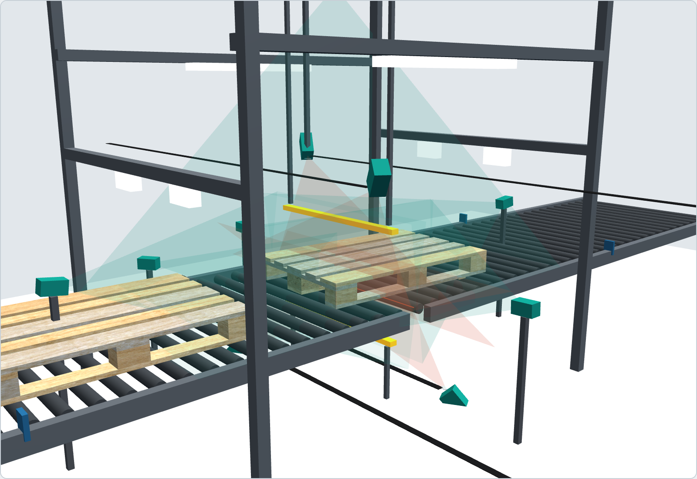
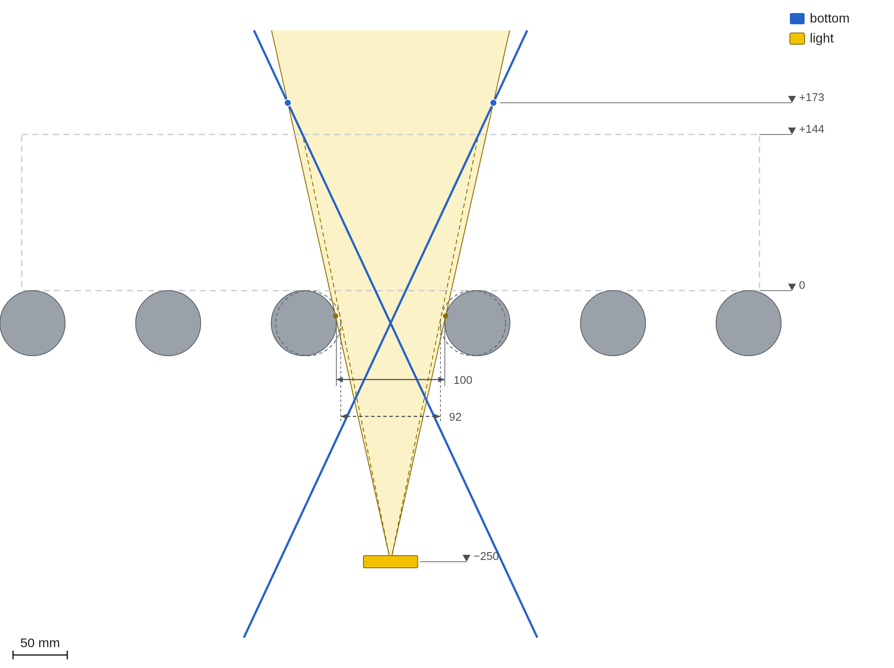
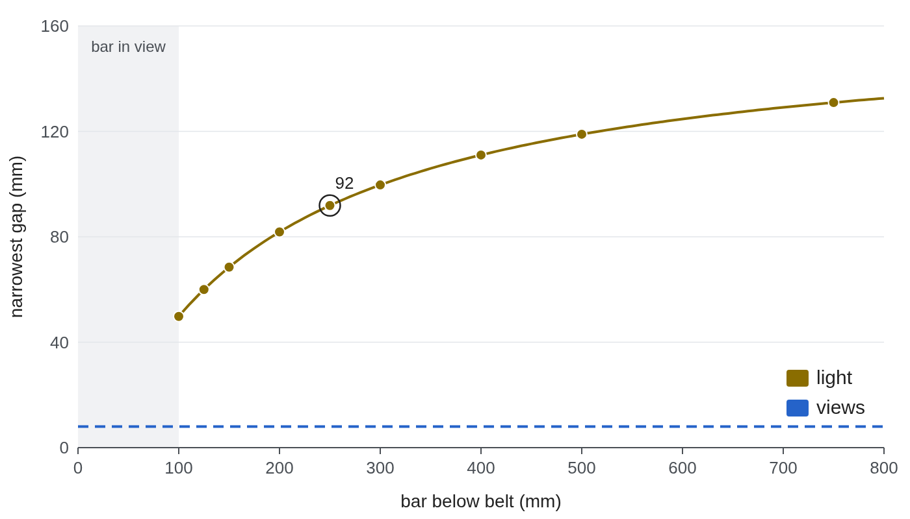
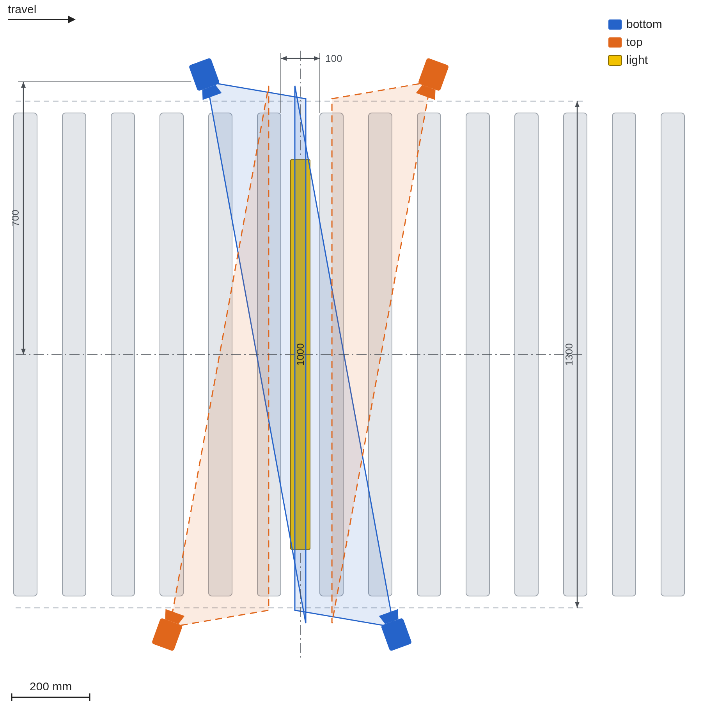
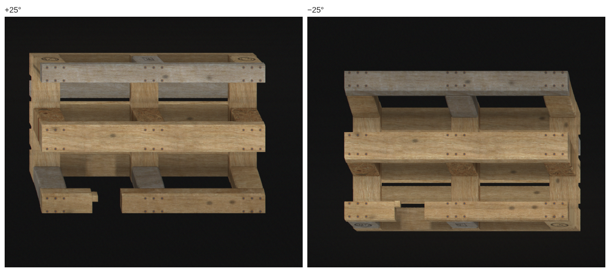
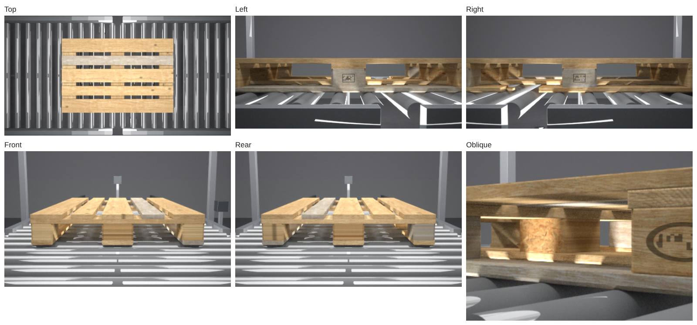
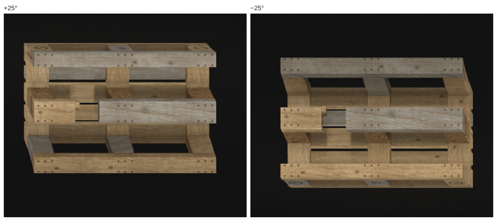
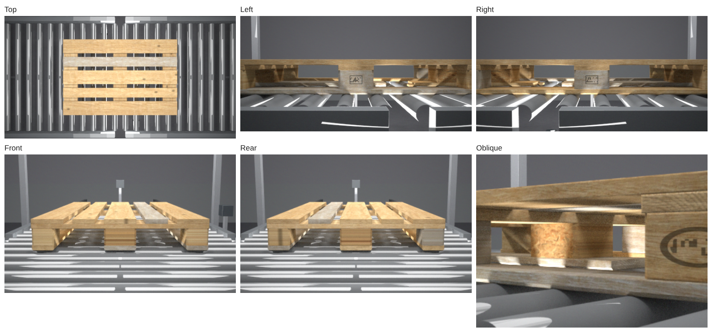
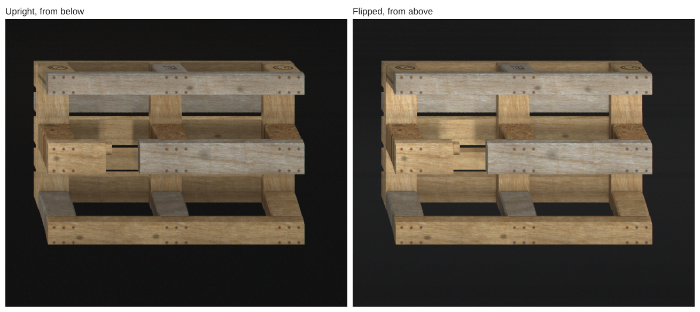
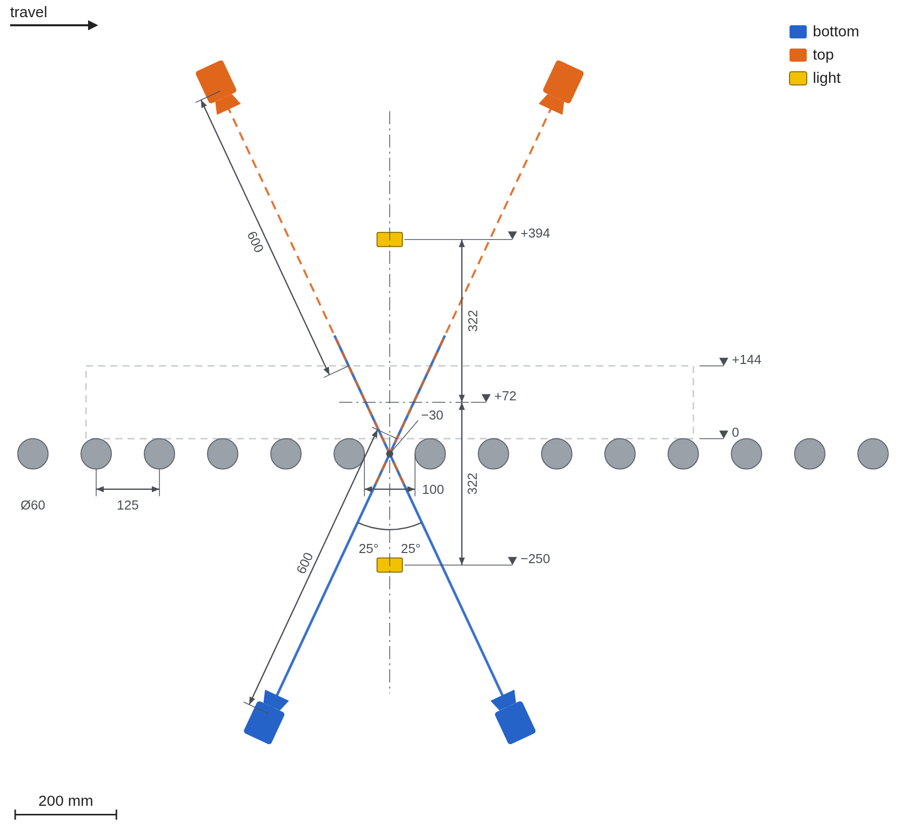

Double-sided linescan concept

*Simulated rig: pallets cross a gap between two conveyor sections, scanned from above and below.*

## Learned
- speeding up the middle conveyor section naturally spaces pallets out
- EPAL pallet damage criteria
- the gap in the conveyor is mostly limited by the geometry of the light bar's light and camera plane

  
  *Bottom light bar at −250 mm: its light fan, not the camera planes, sets how close the rollers can be (92 mm narrowest gap).*

  
  *Narrowest gap vs. how far the bar sits below the belt. The camera views alone would fit through a much smaller gap.*

- four cameras at the corners seems best for detecting errors (tested by comparing the number of pixels changed between damaged/clean)

  
  *Top view: two top and two bottom cameras at opposite corners, each covering the full 1300 mm width.*

## Considerations
### Pros
- complete vision of top and bottom

  
  
  *Broken outer bottom board: line-scan bottom views (±25°) vs. the five-camera setup.*

  
  
  *Broken middle bottom board: line-scan bottom views vs. the five-camera setup.*

- top and bottom images match for AI model

  
  *The same pallet upright from below and flipped from above produce near-identical images.*

- needs no stitching or far camera for long pallets
- can be made compact
- semi-ortho perspective
- can be made without a large cover; cleaning under the gap is easy (broom)
- no limits on pallet rotation

### Cons
- conveyor gap
- cameras at an upwards angle (dust)

  
  *Side view: the bottom cameras look up through the gap at 25°, so their lenses face where dust falls.*

- more complex than 5 cameras
