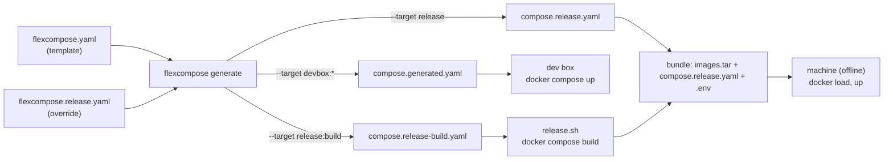
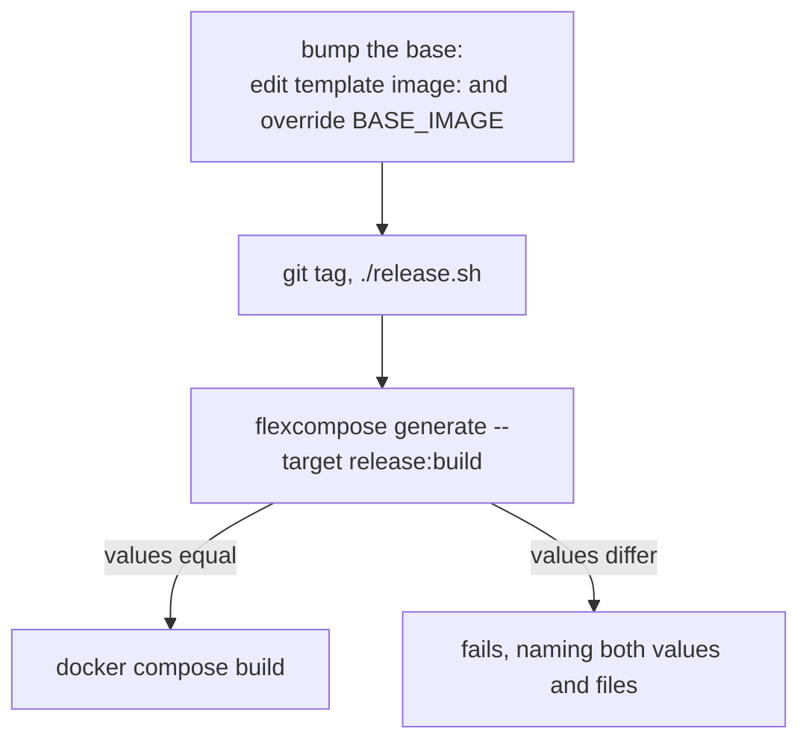
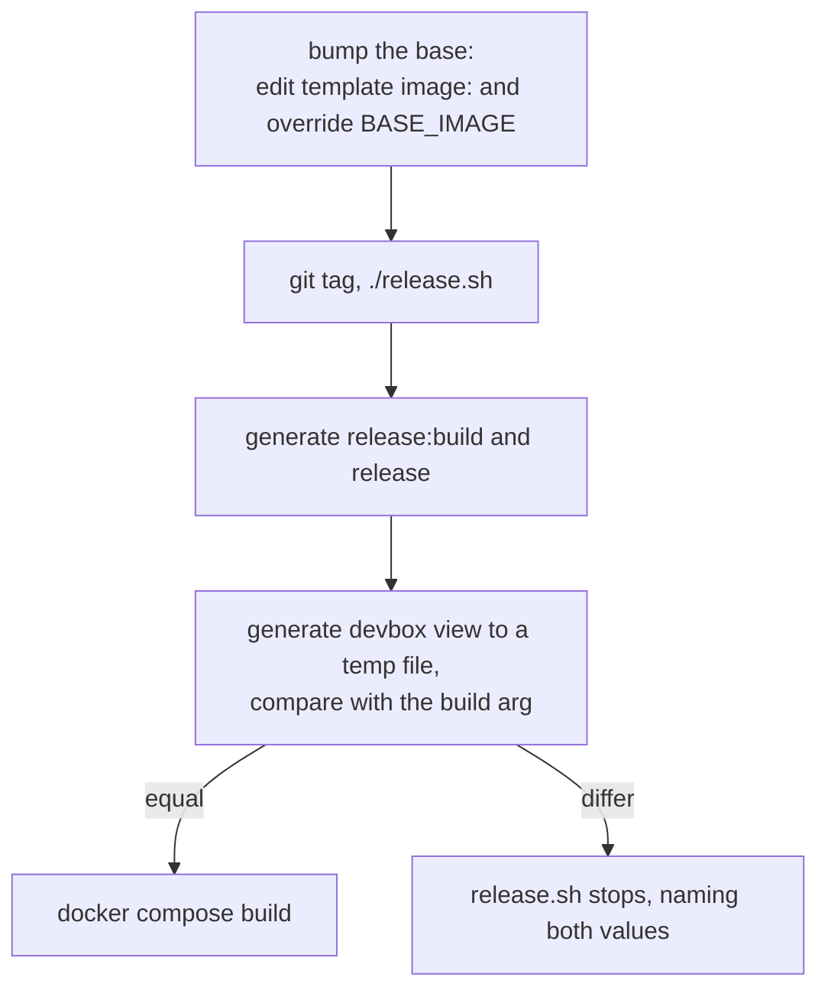
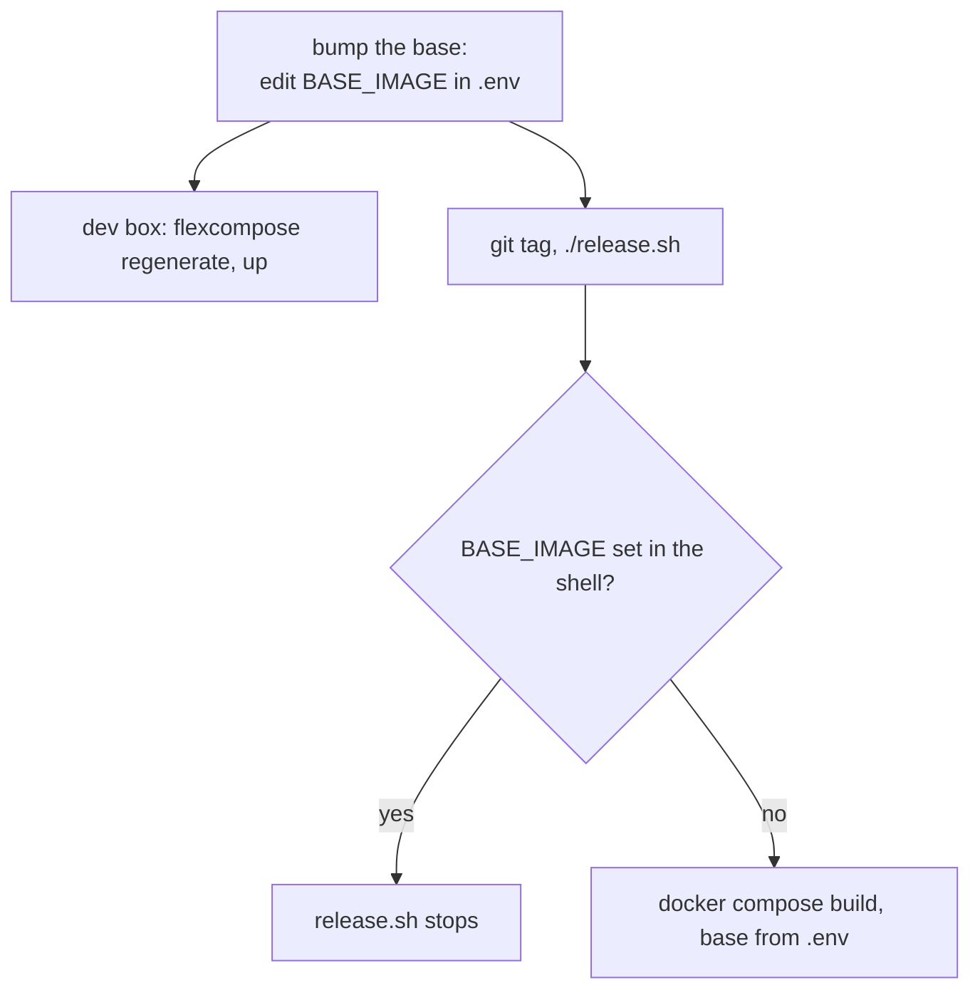
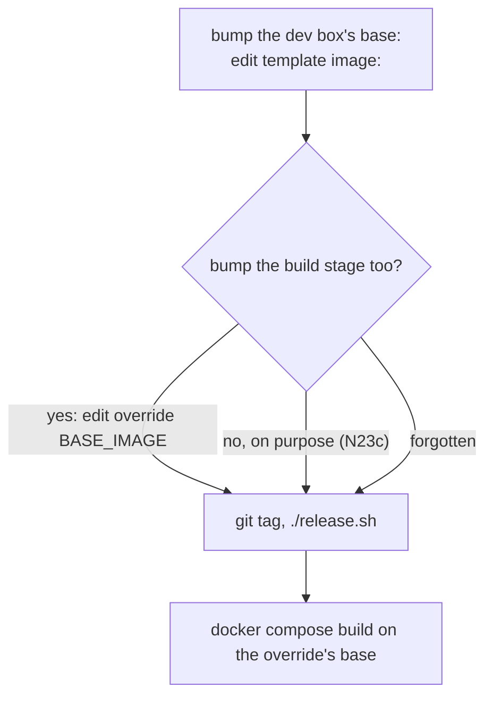

# Building programs with their own recipe: the four choices

A decision aid for the last open choice of the research in `machine-release-programs.md` (round 10, 2026-10-28).
The research log has the requirements, the rejected options and the sources; this document explains what each of
the four remaining choices means in files, in daily work and in FlexCompose's code, so one can be picked.

## 1. What is being decided

A machine's integration repo must run programs that bring their own build recipe, such as the PolyMX inference
service (`nl-polymx-ai-suite-inference`, `Dockerfile.serve`), next to the ROS app it builds itself.

Today `flexcompose generate --target release:build` adds three things to **every** service that has a `build:`:

| Added by FlexCompose | Why it is there | What it does to a program |
|---|---|---|
| `target: release` | builds the starter Dockerfile's stage without source code | breaks the build: `Dockerfile.serve` has no stage named `release` |
| `ssh: [default]` | the app's build clones the private repos of `release.repos` | not needed (the git build context is cloned with the SSH agent anyway) |
| `args: {BASE_IMAGE: <the template's image:>}` | the release builds on the image the dev box runs, named once | meaningless (`polymx-serve`'s own name), ignored by its recipe |

You decided (N22, round 5) that FlexCompose should pass `build:` on **as written**: the output is then predictable
from the files you wrote, a program needs no line that undoes a tool rule, and the tool has fewer rules to keep.
That holds for the app's build too, as a breaking change now (round 7).

Once FlexCompose stops adding `BASE_IMAGE`, the override names the base of the app's **build stage** itself. Today
that is the dev box's image (`release-same-definition`: the release is compiled against the libraries the dev box
tested). Later the build stage may get a smaller image of its own, when the dev box image grows heavy (N23c, could).
F5c, F5d and F2c keep the two equal and have to change when they split; F2 compares nothing, so it allows the split
as it is but doesn't catch a base bump that was forgotten. Everything else is the same for all four (section 2).

## 2. What all four choices share

### 2.1 How the files flow



The override is merged last, per service, for both release targets; the dev box never sees it.

### 2.2 The program's service (identical in all four)

In the template, next to the app:

```yaml
# flexcompose.yaml
services:
  app:
    # ... as today; how its image: is written differs per choice (sections 3-6)
  inference:
    flexcompose_options:
      enable_gpu: true
    image: cboost-c-nas:5100/polymx-serve:<version>          # the name the dev box, the release and the machine use
    pull_policy: build                                       # always built at the pin, never pulled (N20b, N24)
    build:
      context: git@github.com:Cboostbv/nl-polymx-ai-suite-inference.git#<commit>
      dockerfile: Dockerfile.serve                           # the owners' recipe, unchanged
    restart: unless-stopped
    ports: ["127.0.0.1:8080:8080"]                           # the app (network_mode: host) calls 127.0.0.1:8080
    stop_grace_period: 40s                                   # copied from the owners' compose file: an inference finishes on stop
    volumes: [polymx-cuda-cache:/cache/cuda]
volumes:
  polymx-cuda-cache: {}
```

The override doesn't mention `inference`: nothing to undo. `<version>` and `<commit>` are the open pin decision
(the inference repo has no tags yet; a commit SHA works today).

What each file then holds for `inference`:

| File | `inference` gets |
|---|---|
| `compose.generated.yaml` (dev box) | `build:` and `pull_policy: build`: each `up` checks the git context (needs GitHub and your SSH agent) and builds from cache |
| `compose.release-build.yaml` | `build:` exactly as written, nothing added |
| `compose.release.yaml` (machine) | no `build:`, `pull_policy: never`: it runs the image from `images.tar` |

### 2.3 The app's build, written in full by the override

Because FlexCompose adds nothing, the starter's override states the app's whole build. In all four choices it
gains the same two lines, `target` and `ssh`; the base line differs per choice:

```yaml
# flexcompose.release.yaml
services:
  app:
    image: "cboost-c-nas:5100/example-machine:${RELEASE_VERSION:?is set by release.sh from the git tag}"
    build:
      context: .
      target: release        # the Dockerfile's stage without source code
      ssh: [default]         # the build clones the private repositories of release.repos
      args:
        BASE_IMAGE: ...      # per choice (sections 3-6)
    command: ros2 launch example_bringup robot.launch.py
```

The starter's `Dockerfile` is unchanged (`ARG BASE_IMAGE`, `FROM ${BASE_IMAGE} AS build`, `FROM ${BASE_IMAGE} AS
release`).

### 2.4 Where the final image names are given

- **The app**: in the override (`example-machine:${RELEASE_VERSION}`). The template's `image:` is the dev box's base
  image, a different image.
- **A program**: in the template (`polymx-serve:<version>`); the dev box and the machine run the same image.

### 2.5 The shared change to FlexCompose and the repos

| Where | Change |
|---|---|
| `flexcompose-cli/fragments/targets/release-build/compose.yaml` | `target: release` and `ssh` go; the fragment is left empty or removed |
| `flexcompose-cli/release.go` | `addBaseImage` goes; `finishReleaseService` only checks `image:` |
| `flexcompose-cli/output.go:66` | reading the template's `image:` as the base goes (F5c keeps it, for its check) |
| `flexcompose-cli/release_test.go`, `tests/e2e.sh` | tests of the injection replaced by "the build is passed on as written"; e2e gets a program built from another repo's recipe |
| `FLEXCOMPOSE_DESIGN.md` §13 | the `release:build` row says "adds nothing to `build:`" |
| `templates/integration/` | override gains `target`, `ssh` and the base; Dockerfile and template comments updated |
| polymx integration repo | the same override lines (unreleased branch) |

This is a breaking change in FlexCompose's output (`feat!`). An integration repo that isn't migrated fails loudly:
without `BASE_IMAGE`, `FROM ${BASE_IMAGE}` has no image; without `ssh`, `vcs import` can't clone. Without
`target`, Compose builds the last stage, which is `release` in the starter: a test keeps it last.

## 3. F5c: the base written twice, FlexCompose checks it

### Files

```yaml
# flexcompose.yaml
  app:
    image: cboost-c-nas:5100/cboost-ros2-jazzy:0.2.0      # the dev box's image

# flexcompose.release.yaml
  app:
    build:
      args:
        BASE_IMAGE: cboost-c-nas:5100/cboost-ros2-jazzy:0.2.0   # must equal the template's image:
```

### The rule in FlexCompose

For `release:build`, for each `workspace: true` service whose build sets `BASE_IMAGE`: the value must equal the
template's `image:`, or `generate` fails. FlexCompose reads both from the parsed YAML (map or list form of `args`)
and adds nothing. Sketch of the error:

```text
flexcompose.release.yaml: services.app.build.args.BASE_IMAGE is cboost-c-nas:5100/cboost-ros2-jazzy:0.3.0, but the
dev box runs cboost-c-nas:5100/cboost-ros2-jazzy:0.2.0 (flexcompose.yaml); the release must build on the dev box's image
```

### Workflows



- **Bump the base**: edit two lines. Forget one: the dev box runs the new base, and the next release fails at
  `generate`, before building.
- **New machine**: copy the starter; nothing to set up.

### Strengths and weaknesses

| Strengths | Weaknesses |
|---|---|
| One check, written and tested once in Go, the same for every machine | A FlexCompose rule again, of the kind N22 wants fewer of; FlexCompose knows the name `BASE_IMAGE` |
| Reads parsed YAML: every `args` form, clear error naming both files | Changing the rule needs a FlexCompose release |
| The template shows the base literally | If the base-image split lets the build stage use another base (N23c), the rule must change in FlexCompose |
| | Two lines per base bump |

## 4. F5d: the base written twice, `release.sh` checks it

### Files

As F5c: the template's `image:` and the override's `BASE_IMAGE`, both literal. FlexCompose knows nothing about it.

### The check in the integration repo's `release.sh`

After `flexcompose generate --target release:build`:

```bash
# The release builds on the image the dev box runs (FLEXCOMPOSE_DESIGN.md §13): compare them.
tmp=$(mktemp -d)
flexcompose generate --target devbox:host --output "$tmp/devbox.yaml" >/dev/null
devbox=$(docker compose -f "$tmp/devbox.yaml" config --images app)
base=$(docker compose -f compose.release-build.yaml config app | sed -n 's/^ *BASE_IMAGE: //p')
if [ "$devbox" != "$base" ]; then
  echo "The release builds on $base, but the dev box runs $devbox: make BASE_IMAGE in flexcompose.release.yaml equal" >&2
  exit 1
fi
```

Checked on Linux (spikes `spike-checkbase`, `spike-argforms`): `docker compose config` normalizes every `args` form
(map, list, quoted) before `sed` reads it, and a bumped `BASE_IMAGE` is caught. `flexcompose generate --output` to a
temporary folder works, with a warning about relative paths (harmless for `config --images`). Untested: Git Bash
on Windows.

### Workflows



- **Bump the base**: two lines, as F5c; a mismatch stops `release.sh`.
- **New machine**: copy the starter's `release.sh` with the check.
- **A machine that needs another build base** (N23c): edit or drop its own check.

### Strengths and weaknesses

| Strengths | Weaknesses |
|---|---|
| FlexCompose stays free of `BASE_IMAGE`: no tool rule at all (N22's reason in full) | The check is copied into every integration repo's `release.sh`; copies drift, and only the starter's is tested |
| Each machine can adjust or drop it without a FlexCompose release | Six lines of shell per repo; one more `generate` per release |
| The template shows the base literally | Two lines per base bump; a mismatch shows only at release time |

## 5. F2c: the base named once, in a committed `.env`

### Files

```bash
# .env (committed): the dev box's image, which the release builds on
BASE_IMAGE=cboost-c-nas:5100/cboost-ros2-jazzy:0.2.0
```

```yaml
# flexcompose.yaml
  app:
    image: ${BASE_IMAGE:?is set in .env}

# flexcompose.release.yaml
  app:
    build:
      args: [BASE_IMAGE]      # its value comes from .env
```

Compose resolves both from the `.env` next to the generated file, also when started from `.devcontainer/` (as
VS Code Dev Containers does) and with Windows (CRLF) line endings (spike `spike-envbase`). The machine's file needs
no `BASE_IMAGE`: the app's image there is the release image.

### The one weak spot, and its guard

A variable in the shell beats `.env` (Compose's order: shell, `--env-file`, `.env`). A developer with
`export BASE_IMAGE=...` in their profile would build the release on another base without a trace in git. A guard in
`release.sh` closes that for the release:

```bash
if [ -n "${BASE_IMAGE+set}" ]; then
  echo "Unset BASE_IMAGE: the release builds on the base in .env, which the dev box runs." >&2
  exit 1
fi
```

The dev box has no such guard: there a shell `BASE_IMAGE` would change the dev box's image (visible in
`docker compose ps`).

### Workflows



- **Bump the base**: one line; the dev box and the release can't disagree through the files.
- **New machine**: copy the starter, including `.env`.
- **Personal variables** (`WORKSPACES_DIR`, say) must not go in this `.env`: it is committed, and `release.sh`
  refuses a dirty tree (loud, not silent). A developer who ignores `.env` globally in git gets `${BASE_IMAGE:?}`
  failing loudly on a fresh clone.

### Strengths and weaknesses

| Strengths | Weaknesses |
|---|---|
| One edit per base bump; nothing to compare | A new committed file, which Compose also reads for everything else; personal variables have to stay out of it |
| No tool rule; FlexCompose knows nothing of `BASE_IMAGE` | The template shows `${BASE_IMAGE}`; the value is one file away |
| Unaffected by the split: a second variable, or a literal `RELEASE_BASE_IMAGE` in the override | A guard line in each `release.sh`; the dev box side is unguarded |

## 6. F2: the base written twice, nothing compares them

### Files

As F5c and F5d: the template's `image:` and the override's `BASE_IMAGE`, both literal. Nothing checks them:

```yaml
# flexcompose.yaml
  app:
    image: cboost-c-nas:5100/cboost-ros2-jazzy:0.2.0      # the dev box's image

# flexcompose.release.yaml
  app:
    build:
      args:
        BASE_IMAGE: cboost-c-nas:5100/cboost-ros2-jazzy:0.2.0   # the build stage's base; may differ from the dev box's
```

FlexCompose knows nothing of `BASE_IMAGE`, and `release.sh` gets no check. The override says which base the
release compiles on, so the difference from the dev box is explicit in a committed file (`release-differences-explicit`).

### Workflows



- **Bump the base**: two lines while they stay equal. Forget the override: the release compiles on the old base
  while the dev box tested the new one, and nothing reports it. The release still builds and runs; a library
  difference shows up on the machine, if at all.
- **Give the build stage a smaller image** (N23c): edit the override's line; nothing else changes, in FlexCompose
  or `release.sh`.
- **New machine**: copy the starter; nothing to set up.

### Strengths and weaknesses

| Strengths | Weaknesses |
|---|---|
| The least of all four: no check, no `.env`, no tool rule | A forgotten bump goes unnoticed: the release compiles against other libraries than the dev box tested |
| The split (N23c) needs no change anywhere: the build base is already its own line | Two lines per base bump while they are equal |
| The template and the override show both bases literally | Reading the two files is the only way to see whether they differ |

## 7. Side by side

| | Today: FlexCompose adds it | F5c: FlexCompose check | F5d: `release.sh` check | F2c: once in `.env` | F2: twice, no check |
|---|---|---|---|---|---|
| Builds a program with its own recipe | no: the added `target: release` breaks it; each program needs an undo line (`target: ""`, spike `spike-cleartarget`) | yes | yes | yes | yes |
| Breaking change for the two repos | none | yes (section 2.5) | yes | yes | yes |
| Lines per base bump | 1 | 2 | 2 | 1 | 2 |
| Mismatch caught | can't happen: one name, unless the override sets `BASE_IMAGE` itself | at `generate --target release:build` | at `release.sh`, before the build | can't happen in the files; a shell variable is refused by `release.sh` | never |
| Rule lives in | FlexCompose, once (`addBaseImage`, the `release:build` fragment) | FlexCompose, once | each integration repo | `.env` + a guard in each `release.sh` | nowhere |
| FlexCompose knows `BASE_IMAGE` | yes (adds it) | yes (checks, doesn't add) | no | no | no |
| New files | none | none | none | `.env` (committed) | none |
| If the build stage gets its own base (N23c) | the override sets `BASE_IMAGE`, which wins: one line | change FlexCompose | edit or drop the check, in the starter and every repo | one line: the override names the build stage's base (a literal or a second variable) | one line: the override's literal |
| Tested where | FlexCompose's unit tests and e2e | FlexCompose's unit tests and e2e | the starter's e2e only | the starter's e2e only | nothing to test |
| N22's reason "fewer tool rules" | against: three added keys | against | for | for | for |

On the research's requirements (log, *Matrix*, round 10) F2c meets both `release-same-definition` and N23c: when
the build stage gets its own base, the override names it in one line. F5d meets `release-same-definition` only while
its check stays, and the split drops the check; F5c needs a FlexCompose change for the split. F2 is ~ on
`release-same-definition` while the build stage stays on the dev box's base (a forgotten bump isn't caught), and
fits N23c without change. Today's way fails N22 (should, verified): the output isn't what the files say, and
every program needs a line that undoes a tool rule; it is in the table as the baseline. The rest of this table holds the costs no requirement covers, which decide the tie.

## 8. Related decisions this one leaves open

- **Base image split** (TODO.md *Base image*): a slimmer `runtime` image for the shipped stage, through a second
  argument `RELEASE_BASE_IMAGE` in the override. All four choices leave room for it. The build stage may later get
  a smaller base than the dev box too (N23c); that affects F5c most and F2 not at all (section 7).
- **The program's pin**: commit SHA or tags in the inference repo; a git URL or a submodule (F16, which also avoids
  the GitHub fetch on every dev box `up`); the version written twice in the service (image tag and git ref, N17).
- **Who defines how a program runs** (its `stop_grace_period`, network, name): not sure yet; the integration repo
  copies what matters for now.
- **Windows** (N14): the git SSH build context and the `release.sh` additions are untested on Docker Desktop.
