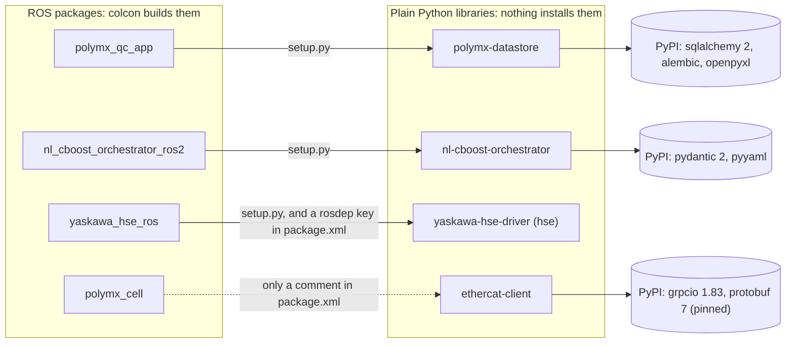
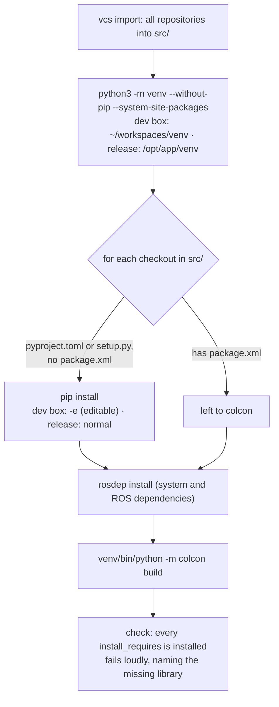

# Python dependencies in polymx: an overview

Status 2026-10-21. A proposal, not built yet. Goal: every Python library says how it is installed, so the
integration repo (`nl-polymx-automated-qc`) does not keep a list of them.

## The problem in one picture

Four libraries are plain Python, not ROS packages. colcon does not build them and rosdep cannot install them, so
today nothing installs them, and the application fails at launch (`No module named 'hse'`).

The arrows already exist in the code, except the dashed one: most ROS packages name their library in `setup.py`
(`install_requires`), and the libraries list their own dependencies in `pyproject.toml`. colcon ignores both.

## Facts, checked in the base image `cboost-ros2-jazzy:0.1.0`

| What | Result |
|---|---|
| colcon | Only the `setup.py` extension: none of the libraries is recognised as a package |
| pip into the system Python | Refused: `externally-managed-environment` (Ubuntu, PEP 668) |
| Ubuntu's own packages | Too old: pydantic 1.10, SQLAlchemy 1.4, grpcio 1.51, protobuf 3.21 |
| `python3 -m venv` | Fails: `python3.12-venv` is missing. `--without-pip --system-site-packages` works |
| pip in that venv | `pip install -e` of the orchestrator and the datastore works; pip fetches pydantic 2.14, SQLAlchemy 2.1 and alembic 1.20 from their `pyproject.toml` |
| ROS start scripts | `colcon build` writes `#!/usr/bin/python3` (the venv is invisible); `venv/bin/python -m colcon build` writes `#!/…/venv/bin/python` (the nodes run in the venv) |

## Recommendation

**Now: a pip convention.** Each repo describes itself; the integration repo runs one generic step that names no
library. **Later: a private package index**, once the libraries have real version numbers.

### Who describes what

| Who | Describes | Where |
|---|---|---|
| A Python library | its own dependencies, with pins where needed | `pyproject.toml` (standard, already there for three of four) |
| A ROS package | the Python libraries it uses | `setup.py`, `install_requires` |
| A ROS package | its ROS and system dependencies | `package.xml` (rosdep), as now |
| The integration repo | which repositories, at which branch or commit | `dev.repos`, `release.repos`, as now |

### The generic step

The same in the dev box (`bootstrap.sh`) and in the release build (`Dockerfile`):

In the release image the venv lives in `/opt/app`, so it travels to the image with the rest of `/opt/app`.

### Changes in the repositories

| Repo | Change | Why |
|---|---|---|
| `nl-yaskawa-ros2-driver` | `yaskawa_hse_ros/package.xml`: drop `<exec_depend>python3-yaskawa-hse-driver</exec_depend>` | `install_requires` has it already; also fixes one of the two rosdep errors |
| `nl-cboost-machine-state-manager` | `package.xml:15`: drop `<buildtool_depend>ament_python</buildtool_depend>` | not a rosdep key; the other rosdep error |
| `nl-polymx-robot` | `polymx_cell/setup.py`: add `ethercat-client` to `install_requires` | today it is only a comment |
| `nl-polymx-ethercat` | an installable root for the client: its own repo, or keep a direct git reference in the consumer for now | the client lives in `client/` of the server repo |
| `yaskawa_hse_driver` | a `pyproject.toml` (to check: no access yet) | so pip can install it |
| `nl-polymx-automated-qc-application` | `package.xml` comment: "see setup.py" instead of BUILD_AND_RUN.md | one place for the truth |
| `nl-polymx-automated-qc` (integration) | the generic step in `bootstrap.sh` and `Dockerfile`; the libraries' repos in `dev.repos` / `release.repos` | the only central part: which repos, not how to install them |

## Options considered

| Option | Verdict |
|---|---|
| **pip convention over the checkouts** (above) | recommended now: no new infrastructure, editable in the dev box |
| **private package index** (CI publishes wheels, e.g. `pypiserver` on the NAS) | the long-term target: real versions, `.repos` only for repos under development |
| central list in the integration repo | what we want to avoid |
| make the libraries ROS packages | colcon still installs no outside packages; ROS metadata in ROS-free libraries |
| rosdep keys that install with pip | the libraries are on no index; no version pins; blocked by PEP 668 |
| direct git references in each consumer | commit pins scattered over repos, clash with editable checkouts; fine as a stopgap for `ethercat-client` |
| uv workspace and lock in the integration repo | good locking, but membership is central again, and ROS packages don't fit |
| Debian packages (bloom, apt repo) | outside packages would need .debs too: too heavy |
| bake into the base image | central and slow to change |

## Open points

- **Reproducibility:** outside packages (`pydantic>=2` …) are resolved again at every build. At least record
  `pip freeze` in the release bundle; a lock or constraints file generated at release time is the step after.
- **`hse`:** access to `cboostjvisser/yaskawa_hse_driver`, and which branch (`main` per the application's draft).
- **`ethercat-client`:** split out or direct reference.
- **Base image:** add `python3-venv`? Not needed with `--without-pip`; could go with the SSH request to its owner.
- Not urgent while a colleague reorganises the branches and dependencies; the repo changes are best made with them.
