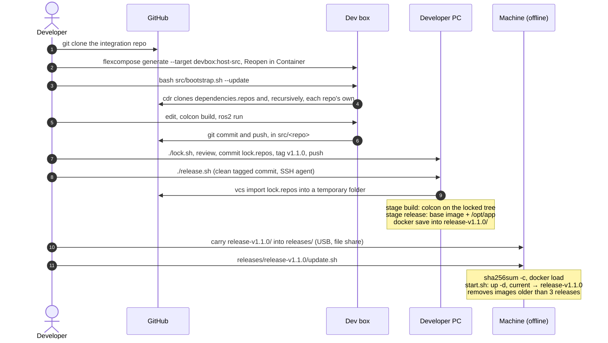
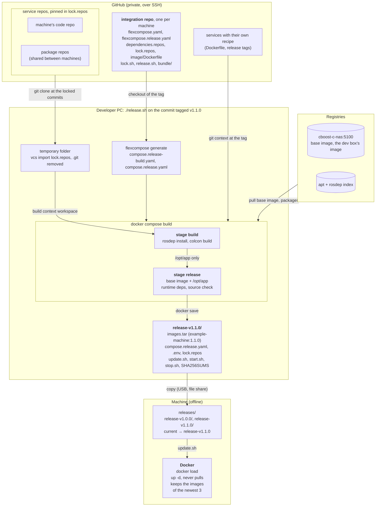

# Integration repo starter

The starter for a machine's integration repo: one repo per machine that holds its dev box, the generic recipe of
its source-built service and its release ([design](../../FLEXCOMPOSE_DESIGN.md) §13). Service repos hold only code
and their `dependencies.repos`; a service with a recipe of its own (a Dockerfile, release tags) is built from its
repo. You need `flexcompose` on your `PATH` (see the root [README](../../README.md#install)); for a release also
Docker with buildx, `cdr` and `vcs` (`pip install <nl-cboost-ros-tools>/tools vcs2l`) and an SSH agent.

| File | What it is |
|---|---|
| `flexcompose.yaml` | The template, for the dev box and the release |
| `flexcompose.release.yaml` | How the release differs: the release `image:`, its `build:` and the real `command:` |
| `dependencies.repos` | The repositories this machine builds from source, for `cdr`; each brings its own dependencies |
| `lock.repos` | The exact commit of every repository in the release; `lock.sh` writes it, you commit it |
| `bootstrap.sh`, `.devcontainer/` | The dev box: system dependencies on every open; `--update` clones and syncs |
| `lock.sh`, `release.sh`, `image/Dockerfile` | The release: the lock, then the images built from it, and the machine's bundle |
| `bundle/` | `start.sh`, `stop.sh`, `update.sh`: `release.sh` puts them in the bundle, for the machine |
| `.gitignore`, `.gitattributes` | Keep checkouts, outputs and bundles out of git; LF line endings for the Linux side |

## Checklist

1. **Copy** this folder into a new repo for the machine, and commit it.
2. **Adjust**:
   - `dependencies.repos`: the repositories your machine uses directly (each repository lists its own dependencies in
     its own `dependencies.repos`).
   - `flexcompose.yaml`: `image:` your base image, pinned to a version; the features (the release gets them too);
     services with a recipe of their own, each by its git tag.
   - `flexcompose.release.yaml`: the release image's name (keep `${RELEASE_VERSION...}` as its tag), the
     `command:` the machine runs, and `BASE_IMAGE` (usually the template's `image:`).
   - Renamed the service `app`? Change it in `flexcompose.release.yaml` and in `"service"` in
     `.devcontainer/devcontainer.json` too.
3. **Dev box**: `flexcompose generate --target devbox:host-src`, open the folder in VS Code, choose *Reopen in
   Container*, then once: `bash src/bootstrap.sh --update`. It clones the repositories into `src/`, next to each
   other. Work, commit and push in those checkouts.
4. **Release**: write the lock, review and commit it, tag the commit with the version and run `release.sh`:
   ```sh
   ./lock.sh && git diff lock.repos
   git commit -m "lock v1.1.0" lock.repos
   git tag -a v1.1.0 -m v1.1.0
   ./release.sh
   ```
   It writes `release-v1.1.0/`. On the machine, copy that folder next to the earlier releases and run its
   `update.sh`, which also starts it (also when the release was stopped); `current/stop.sh` and `current/start.sh`
   stop and start the release that runs:
   ```sh
   releases/release-v1.1.0/update.sh
   ```

With `devbox:host` or `devbox:volume`, the box's `src/` starts empty: clone this repo into it once, in the box
(`git clone <this repo> ~/workspaces/src`), then use `bash src/bootstrap.sh --update` as above; Dev Containers runs
that copy's `bootstrap.sh` on every open. Generate the box from the host copy; work and commit in the box's copy.

## Workflows

| Action | Commands | What happens |
|---|---|---|
| Take in newer commits | `bash src/bootstrap.sh --update` | `cdr` puts followed branches on their pins; it refuses uncommitted changes and keeps local commits ahead |
| A repository is missing | `bash src/bootstrap.sh --update` | An open says "nothing is checked out yet", or rosdep can't find a package and prints the hint |
| Bump or add a dependency | edit `dependencies.repos` in the repository that uses it, commit, push | Others get it with `--update`; a conflict names both owners: agree, or `override: true` in this repo's file |
| Take a new version of a service with its own recipe | bump both literals (`image:` tag, `#v<version>`), commit; others: `docker compose -f compose.generated.yaml up -d` | Compose builds the new tag once, then reuses it offline |
| Bump the base image | the template's `image:` and the override's `BASE_IMAGE:` | Both literals by hand |
| Rebuild an old release | `git checkout v1.0.0 && ./release.sh` | The same source commits, from that tag's lock |
| New customer | `git switch -c customer/acme v1.1.0`; configuration in the Compose files or mounted files; other versions in `dependencies.repos` (`override: true` if needed), `./lock.sh`, commit | Configuration is never baked into the images |
| Customer release | on `customer/acme`: `./lock.sh`, commit, `git tag -a v1.1.0+acme -m v1.1.0+acme`, `./release.sh` | Images tagged `1.1.0_acme`; a release with the same inputs reuses the image on the same PC |
| Work on a customer's setup | `git switch customer/acme`, `bash src/bootstrap.sh --update`; Rebuild if the template changed | Without `--update` you work on the previous branch's versions |
| Fix for all customers (this repo) | fix on `main`, tag, release; per customer: `git merge v1.1.1`, on a `lock.repos` conflict take either side and `./lock.sh`, commit, tag `v1.1.1+acme`, release | One merge per customer branch |
| Fix for all customers (a service repo) | fix on the line each customer follows; per branch `./lock.sh`, commit, tag, release | Re-locks, no merges |

`release.sh` refuses: uncommitted changes or untracked files (ignored ones aside), a commit without a version tag,
and a `lock.repos` written for another `dependencies.repos` (a pin changed without `./lock.sh`). It builds from the
committed lock only, never from your checkouts: push and lock a fix before you release it.

More: the root [README](../../README.md#releases) and design §13.

## Diagrams

The steps above, from the dev box to the machine (a Mermaid diagram; GitHub renders it):



Where each part of a release comes from, and the only network access, on your PC:


