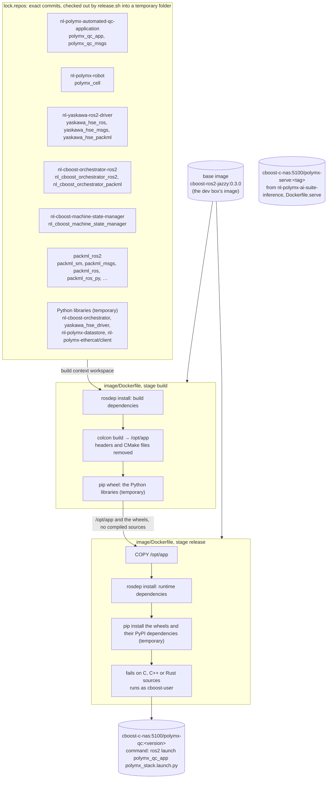

# nl-polymx-automated-qc

The integration repo of the PolyMX Automated Quality Control machine: its dev box, the recipe of its application
image and its release, made with [FlexCompose](https://github.com/Cboostbv/nl-cboost-flexcompose) from its
integration starter. The machine's code lives in the repositories `dependencies.repos` names, and in theirs; this
repo holds no code of its own. Inference is built from its own repo, `nl-polymx-ai-suite-inference`, at a tag.

| File | What it is |
|---|---|
| `flexcompose.yaml` | The template, for the dev box and the release: the app and inference |
| `flexcompose.release.yaml` | How the release differs: the app's release image, its build and its `command:` |
| `dependencies.repos` | The repositories this machine builds from source, for `cdr`; the application brings its own |
| `lock.repos` | The exact commit of every repository in the release; `lock.sh` writes it, you commit it |
| `bootstrap.sh`, `.devcontainer/` | The dev box: system and Python dependencies on every open; `--update` clones and syncs |
| `lock.sh`, `release.sh`, `image/Dockerfile` | The release: the lock, then the images built from it, and the machine's bundle |
| `bundle/` | `start.sh`, `stop.sh`, `update.sh`: `release.sh` puts them in the bundle, for the machine |

## Quickstart

You need Docker, VS Code with the Dev Containers extension, `flexcompose` on your `PATH`
([install](https://github.com/Cboostbv/nl-cboost-flexcompose#install)), and an SSH agent with your GitHub key
(`ssh-add -l` lists it).

**Dev box:**

```sh
git clone git@github.com:Cboostbv/nl-polymx-automated-qc.git
cd nl-polymx-automated-qc
flexcompose generate --target devbox:host-src
code .            # then: Reopen in Container
```

In the box, once, then whenever you want newer commits:

```sh
bash src/bootstrap.sh --update      # clones or syncs the repositories into src/ (cdr)
colcon build --packages-up-to polymx_qc_app
source install/setup.bash
```

An open never clones or moves a checkout; it installs the system and Python dependencies of what is in `src/`.
Inference runs next to the app, built once from its tag; the app reaches it at `127.0.0.1:8080`. How to run and test
the application: `src/nl-polymx-automated-qc-application/docs/BUILD_AND_RUN.md`.

**Release:** write the lock, review and commit it, tag the commit with the version and run `release.sh`:

```sh
./lock.sh && git diff lock.repos
git commit -m "lock v1.0.0" lock.repos
git tag -a v1.0.0 -m v1.0.0
./release.sh      # writes release-v1.0.0/: the images, lock.repos and the machine's scripts
```

`release.sh` builds from the committed `lock.repos` only, never from your checkouts: push and lock a fix before you
release it. It refuses a `lock.repos` written for another `dependencies.repos`. On the machine, copy
`release-v1.0.0/` next to the earlier releases and run its `update.sh`. A customer release lives on a branch
`customer/<name>` and is tagged `v1.0.0+<name>` (images `1.0.0_<name>`). More: the FlexCompose README, section
*Releases*, and the starter's workflows table.

## How the release image is built



The dev box builds the same repositories, from `dependencies.repos`, with `colcon build` in `src/`, and installs the
Python libraries editable from their checkouts.

## Status

Migrating to the FlexCompose integration starter with `cdr` on `feat/flexcompose-integration`:

- `lock.repos` is not written yet: `./lock.sh` once the base image `cboost-ros2-jazzy:0.3.0` (with `cdr` and
  `vcs2l`) exists and the URLs of `yaskawa_hse_driver` and `nl-polymx-datastore` are confirmed.
- Temporary until the application's Python libraries are ROS packages: they are listed in `dependencies.repos` and
  installed with pip (in `bootstrap.sh` and `image/Dockerfile`); their own PyPI dependencies are unpinned, and the
  EtherCAT client's commit is written twice (here and in the application's `requirements-ethercat.txt`).
- Temporary until the application's `dependencies.repos` is fixed: overrides for `nl-cboost-orchestrator-ros2` and
  `nl-polymx-robot` (the branches it names no longer exist).
- The patched Fast DDS and rclpy (`docs/fastdds-shm-deployment.md` in the application) are not in the release image.
- Inference has no release tag yet: tag `nl-polymx-ai-suite-inference` `v1.0.0` before the first build.
- `rosdep install` failed on two keys: `ament_python` (`nl-cboost-machine-state-manager`) and
  `python3-yaskawa-hse-driver` (`nl-yaskawa-ros2-driver`); recheck after the migration.
