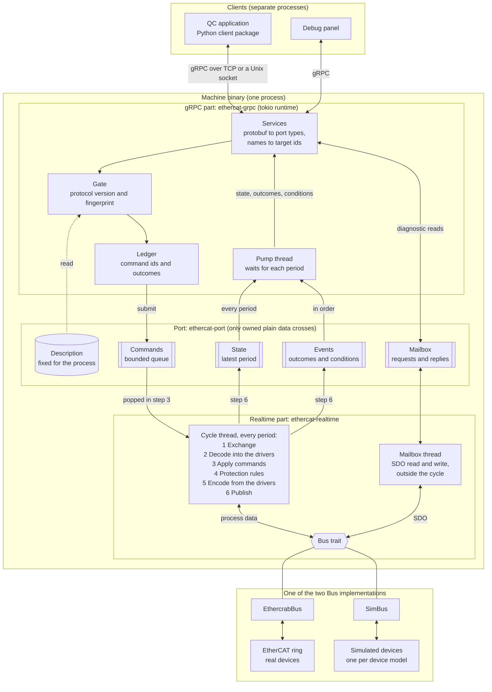
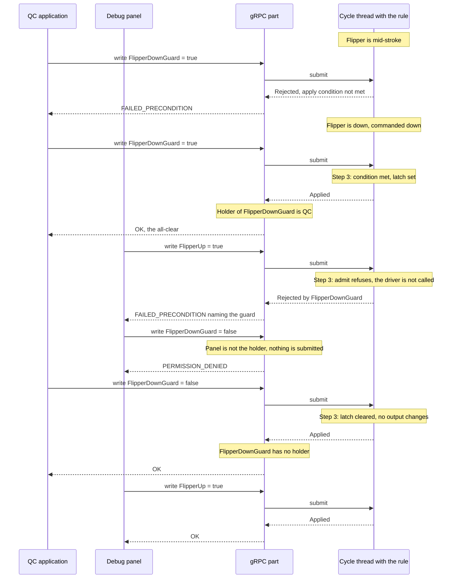

# EtherCAT server: split architecture proposal

Nov 10, 2026 · @Chiel Douwes

## Summary

The server becomes two parts in one process, joined by one narrow interface called the **port**.

- **Realtime part** (`ethercat-realtime`): one cycle thread that owns the EtherCAT master, the device drivers and the protection rules. It shares no thread, lock or async runtime with the gRPC part and knows nothing about clients.
- **gRPC part** (`ethercat-grpc`): serves the machine to clients. It owns the handshake, command ids and streams. It accepts connections from anything that implements tokio's `AsyncRead + AsyncWrite`, so TCP, a Unix socket and an in-memory pipe are all the same code path.
- **Port** (`ethercat-port`): three wait-free channels between them, plus a mailbox channel served outside the cycle. Commands go in through a bounded queue. The latest machine state and a stream of events come out.

The main reasons:

1. The cycle thread can't be delayed by a client. Nothing it does takes a lock, allocates or wakes a task that the gRPC part controls.
2. Each part is tested alone. The gRPC part runs against a scripted port, the realtime part runs with no socket.
3. The port is the only contract. Another front end (for example a ROS 2 bridge) attaches to it without touching the realtime part.

Status: proposal. It is based on `generic-problem-statement.md` and `generic-api-proposals.md` in the notes vault. Choices that rest on unverified requirements are marked.

## Context

Today's server (`0.0.5`) has the two concerns in one piece. gRPC handlers run on tokio tasks and call driver methods directly, while the cycle thread calls `update()` on the same drivers. Drivers therefore lock their own state (spin mutexes, atomics, watch channels), sessions are a separately locked store, and a 5 ms tokio task coordinates sessions, faults and health under lock-order rules. `grpc_server::run` takes seven `&'static` references into that shared state and a TCP address string.

This causes three problems:

- **No place for in-cycle protection rules.** A rule that reads inputs and forces outputs in the same cycle would be one more party to the locking (`generic-polymx-split.md`, *Current state*).
- **The cycle depends on handler behaviour.** A handler that holds a driver lock delays the cycle thread.
- **The transport is fixed.** The address is parsed as a `SocketAddr`, so only TCP works. Tests need a real port.

Six independent designs for the generic core agreed on the cure for the first two: one cycle thread owns the bus, and the application side reaches it only through a queue and a published snapshot (`generic-api-proposals.md`, *What held up*). This proposal turns that agreement into a crate boundary with a defined API, and adds the transport abstraction.

## Requirements and assumptions

Only the rows marked *verified* are settled. The rest are taken from the request or from the notes and still need confirmation. R and N numbers refer to `generic-api-proposals.md`, M numbers to `generic-polymx-split.md`.

| # | Requirement | Priority | Status | What it decides here |
| --- | --- | --- | --- | --- |
| Q1 | The server is split into a realtime bus part and a gRPC communication part | Requested | From the user (2026-11-10). Reasons (2026-11-11): timing isolation (a realtime-priority cycle thread, a non-realtime server thread), testing, other front ends later, separation of concerns. Crash isolation is nice to have, not required | The two parts and the port; one process (A1) |
| Q2 | The gRPC part serves over any socket, expressed through a trait | Requested | From the request (2026-11-10); reason not stated | The `serve` signature |
| R5 / M2 | Protection rules react within one period and keep acting when the device exchange fails | Must | Verified (2026-11-09) | Rules run in the realtime part, never behind the port |
| M5 | The application is a separate process that imports a client package | Must | Verified (2026-11-03) | A network protocol is needed at all |
| GA1 | The server takes no action when a client goes quiet | Won't | Verified (2026-11-09) | No leases or heartbeats in either part |
| R9 | The stack runs in full without hardware. The simulated devices mirror the real devices as closely as possible, so the real driver code is what runs under simulation | Must | Verified: simulator (2026-11-09), real driver code under simulation (2026-11-11). Reason: the driver code is to be tested without the rig | Simulation sits below the drivers, inside the realtime part. Drivers reach devices through `Bus`, not through ethercrab types |
| C1 | Servo motion and distance sensors can be simulated | Could | Priority confirmed by the user (2026-11-11) | The iX7NH, ECOMODUL and EL6224 simulated devices come later; the `SimDevice` contract must allow them |
| R1 | Fixed period per machine; missed periods are visible | Should | Proposed | Overruns are counted in the published state |
| Q4 | A machine keeps one period. If it is too slow for a device, the period is adjusted | Requested | From the user (2026-11-11) | One `period` in `Description`; no second cycle rate or bus group |
| Q5 | Only one front end is attached at a time | Requested | From the user (2026-11-11) | `Port` has one owner; command ids and client identity stay in the front end |
| Q6 | SDO access at runtime has a write path | Requested | From the user (2026-11-11), in reply to the recovery snag | The mailbox channel writes as well as reads; see *Mailbox channel* |
| Q7 | Several clients may command at the same time. What they may do is limited by the protection rules, not by a single-commander rule | Requested | From the user (2026-11-12); replaces the earlier assumption of one commanding client | No arbitration in the gRPC part. The ledger keys command ids per client |
| Q8 | A client can apply a client-held guard: a protection rule that acts from then until that client releases it. Applying succeeds only when the guard's apply condition is already met. The gRPC part enforces that only the holder releases | Requested | From the user (2026-11-12). Example given: the flipper stays put while the robot approaches. The server can't see the robot | *Client-held guards*; rules can refuse a command before it reaches a driver |
| Q9 | An IO-Link sensor is a named entry in the machine file that points at its master and port, and is addressed by that name | Requested | From the user (2026-11-12): chosen for now. IO-Link devices as their own entry with several targets are a later expansion | *IO-Link sensors* |
| R6 | A command never takes effect twice; an unknown outcome is reported as unknown | Should | Proposed | Command ids and the ledger in the gRPC part |
| R7 | Every value carries its age; absent data is never shown as a value | Should | Proposed | Per-device freshness in the state |
| R8 | A client built against an incompatible version can't change outputs | Should | Proposed | The handshake in the gRPC part |
| A1 | The two parts run in one process | Assumption | Mine; fits Q1, which doesn't require crash isolation. See *Alternatives* | Port is in-memory. Only owned, plain data crosses it |
| Q3 | Linux in deployment; the server also runs on Windows for testing | Requested | From the user (2026-11-11) | The port uses nothing Linux-only. Realtime thread setup and Unix sockets are Linux-only extras |

## Architecture



Commands flow down through one queue; state and events flow up. The cycle thread's six steps are one period. Nothing in the gRPC part is called by, or can block, the cycle thread. Mailbox requests take a separate path through the mailbox thread and never run on the cycle thread.

## Realtime part

The realtime part is everything that must happen every period: the exchange with the ring, the device drivers, the machine's protection rules. It is a library with one entry point.

```rust
/// Checks the ring against the machine description, then starts the cycle thread.
pub fn start(
    machine: Machine,          // parsed machine.toml
    bus: impl Bus,             // EthercrabBus or SimBus
    rules: Rules,              // the machine's protection rules
    realtime: RealtimeConfig,  // period, priority, core
) -> Result<(Port, CycleThread), StartError>;
```

`Port` is the application's end of the interface (next section). `CycleThread` is a handle with `stop()` and `join()`; `join()` returns why the cycle ended.

Every period the cycle thread runs the order all six earlier designs converged on:

1. **Exchange** process data with the ring.
2. **Decode** the inputs into driver state. A failed exchange marks the affected devices as not fresh.
3. **Apply commands**: pop at most a fixed number from the port. Each command is first put to the rules (`admit`). A refused command gets `Rejected` naming the rule and never reaches a driver. An admitted command is handed to its driver. A command is popped only when an event slot is free for its outcome.
4. **Run the protection rules.** They see the decoded inputs and can force outputs or stop axes. They run after the commands, so a rule has the last word, and they run when the exchange failed too.
5. **Encode** the outputs for the next exchange.
6. **Publish** the state and this period's events to the port.

Rules for code on the cycle thread:

- **No lock shared with another thread.** The thread owns all driver, rule and command state outright, so drivers lose their interior locking.
- **No allocation after startup.** Queues, the state buffer and driver state are sized from the machine description.
- **No blocking call except the exchange and the pacer's sleep.**
- **Bounded work per period.** The command limit in step 3 keeps a flood of commands from stretching a period.

Ethercrab is async. Its futures stay on an executor private to the cycle thread, as in today's `Ethercat::run_blocking`. The gRPC part's tokio runtime is a different runtime on different threads.

Thread setup (`SCHED_FIFO`, `mlockall`, a pinned core) is done by `start` from `RealtimeConfig`. It is Linux-only. On Windows the cycle thread runs without it, which is enough for testing and gives no timing guarantee (Q3). Startup work (discovery, the topology check, SDO configuration) runs before the first period. On a ring mismatch the bus stays in PRE-OP, the port still opens, the state carries the mismatch report, and every command is rejected.

A panic on the cycle thread ends the process. The devices' own watchdogs then take the outputs to their safe state.

## SimBus and simulated devices

Status: proposed, written without a design run. The signatures are a sketch; they are settled in step 3.

R9 asks that the real driver code runs under simulation. That needs two things the server lacks today. Drivers take ethercrab's `SubDeviceRef` directly, so nothing else can stand in for the ring. And simulation replaces the driver instead of the device: the `Simulated` driver for terminals, and a `new_simulated` mode inside the iX7NH and ECOMODUL drivers.

### The `Bus` trait

`Bus` is everything the realtime part uses from the ring. Today's drivers and startup code use seven ethercrab calls (`sdo_write`, `sdo_read`, `name`, `identity`, `configured_address`, `inputs_raw`, `outputs_raw_mut`); the trait covers those, the state transitions and the exchange.

```rust
/// Implemented by EthercrabBus and SimBus. Drivers and the cycle see only this.
pub trait Bus {
    /// What is on the ring, in ring order: name, vendor, product, revision.
    fn discover(&mut self) -> Result<Vec<Identity>, BusError>;

    /// SDO access for startup configuration. Blocking; not called once the cycle runs.
    fn sdo_read(&mut self, device: Slot, index: u16, sub: u8, into: &mut [u8]) -> Result<usize, SdoError>;
    fn sdo_write(&mut self, device: Slot, index: u16, sub: u8, data: &[u8]) -> Result<(), SdoError>;

    /// Take the ring to PRE-OP, SAFE-OP or OP. A device can refuse, and the error names it.
    fn request_state(&mut self, state: AlState) -> Result<(), BusError>;

    /// One process data exchange with the whole ring.
    fn exchange(&mut self) -> Result<(), ExchangeError>;

    /// A device's process data: the inputs of the last exchange, the outputs for the next.
    fn image(&mut self, device: Slot) -> Image<'_>;   // { inputs: &[u8], outputs: &mut [u8] }

    /// SDO and register access for the mailbox thread, usable while the cycle runs.
    fn mailbox(&self) -> Self::Mailbox;
}
```

`EthercrabBus` wraps today's ethercrab calls and runs their futures on the cycle thread's private executor. Nothing above `Bus` names an ethercrab type.

### Simulated devices

`SimBus` holds one simulated device per ring position. A simulated device stands for one device model and lives next to that model's driver.

```rust
pub trait SimDevice {
    fn identity(&self) -> Identity;

    /// The object dictionary. An object or value the real device refuses is refused here, with the same abort code.
    fn sdo_read(&mut self, index: u16, sub: u8, into: &mut [u8]) -> Result<usize, SdoError>;
    fn sdo_write(&mut self, index: u16, sub: u8, data: &[u8]) -> Result<(), SdoError>;

    /// A state request. Refused where the real device refuses, for example on a PDO mapping it doesn't support.
    fn request_state(&mut self, state: AlState) -> Result<(), AlError>;

    /// One period: take the outputs, advance the device by `period`, produce the inputs, in the real PDO layout.
    fn exchange(&mut self, outputs: &[u8], inputs: &mut [u8], period: Duration);

    /// One period without an exchange. Runs the device's watchdog, as configured over SDO.
    fn missed(&mut self, period: Duration);
}
```

Rules for a simulated device:

- **It is written from the manual and from what the rig showed, not from the driver.** It calls no driver code. A rig finding that the manual doesn't state (for example the ECOMODUL's sync errors above a 5 ms period) is added with a note of where it was measured.
- **It refuses what the real device refuses.** An unknown object, a value out of range or a wrong order of state requests fails the same way, so a driver mistake shows up as a failed start.
- **It has no clock.** Simulated time is the number of exchanges times the period, so tests are deterministic and don't sleep.
- **A ring position without a simulated device fails `SimBus::new`**, naming the model.

Tests reach the simulation through a handle returned with the bus: `SimBus::new(&machine) -> (SimBus, SimHandle)`. The handle sets what the outside world does to a device (an input level, a measured distance, a load on an axis), injects faults (a lost exchange, a device that drops out, a drive fault, a ring that differs from the description) and reads back every output image that was exchanged.

### Which models exist

| Device model | Simulated device | Priority |
| --- | --- | --- |
| EL1008, EL2008 | Input and output image; replaces today's `Simulated` driver | Part of R9: without them no machine runs on `SimBus` |
| EL4002 | Output image and its startup SDOs | Part of R9 |
| iX7NH | DS402 state machine, homing, motion profile, drive faults | Could (C1) |
| ECOMODUL | Same, per axis | Could (C1) |
| EL6224 with ILR1040 | IO-Link port states and distance readings | Could (C1) |

Until a C1 model exists, its driver keeps its `new_simulated` mode, as today. That driver's bus code is then not exercised by `SimBus`; only its command and state logic is. The Python end-to-end tests for the sled and the light lift keep working on that mode.

### Checking the simulation against the rig

A simulated device is only as right as the knowledge it was written from. If the driver and the simulated device share one misreading of the manual, the tests pass and the rig fails. Recordings close that hole:

- A wrapper around `EthercrabBus` records, on the rig, the startup SDO sequence and every period's input and output bytes for a scenario (enable, home, move, stop, a fault).
- A replay test feeds the recorded outputs to the simulated device and compares its inputs with the recorded ones, field by field. Which fields must match exactly and which within a tolerance is set per model.
- Every quirk found on the rig is added as a recording.

### What `SimBus` doesn't cover

- **ethercrab and the NIC.** Simulating at Ethernet-frame level would cover them, but needs the ESC registers, the EEPROM and the CoE mailbox protocol per device.
- **Bus timing:** jitter, distributed clocks and frame loss, other than the faults injected through the handle.
- **Real device behaviour beyond the model.** What the devices do when the server dies is checked on the rig (see *Planned tests*).

## The port

The port is the whole contract between the two parts: one fixed description, commands in, state and events out. It lives in its own crate of plain types, with no dependency on ethercrab, tokio or tonic.

```rust
/// The application's end. Exactly one exists; it is not Clone.
pub struct Port {
    pub description: Arc<Description>,
    pub commands: Commands,
    pub updates: Updates,
    pub mailbox: Mailbox,
}

impl Commands {
    /// Never blocks. `Full` means the command was not queued and will not take effect.
    pub fn submit(&mut self, command: Command) -> Result<(), Full>;
}

impl Updates {
    /// Blocks until the cycle thread has published a newer period.
    pub fn wait(&mut self) -> Update<'_>;
}

pub struct Update<'a> {
    pub state: &'a State,     // the latest period; earlier ones may have been skipped
    pub events: Events<'a>,   // every event since the previous call, in order
    pub events_lost: u64,     // conditions dropped because this side fell behind; outcomes are never dropped
}
```

### What crosses it

```rust
/// Fixed for the life of the process.
pub struct Description {
    pub boot_id: BootId,            // new on every start
    pub fingerprint: Fingerprint,   // hash of the machine description
    pub period: Duration,
    pub targets: Vec<TargetInfo>,   // name, kind, unit, direction, limits, device
    pub rules: Vec<RuleInfo>,
}

pub struct Command {
    pub id: CommandId,      // chosen by the sender, echoed in the outcome
    pub target: TargetId,   // index into Description::targets
    pub action: Action,     // write a value, or a device operation (home, move, stop)
}

pub struct State {
    pub period: u64,              // counter since start
    pub at: Instant,              // monotonic time of this period's exchange
    pub bus: BusState,            // operational or mismatch report, overruns, failed exchanges
    pub readings: Box<[Reading]>, // one per target, in Description order
}

pub struct Reading {
    pub value: Value,
    pub fresh_at: Option<u64>,    // period of the last valid exchange; None = never read
    pub forced_by: Option<RuleId>,
}

pub enum Event {
    Outcome { id: CommandId, outcome: Outcome, period: u64 },
    Condition { source: Source, change: Change, period: u64 },  // fault raised or cleared
}

pub enum Outcome {
    Applied,            // carried by an exchange the devices acknowledged
    Rejected(Reason),   // never reached the outputs
}
```

### How each channel behaves

| Channel | Direction | Mechanism | When the other side is slow or gone |
| --- | --- | --- | --- |
| Commands | in | Bounded single-producer, single-consumer ring | `submit` returns `Full`. The command is not queued |
| State | out | Latest-value buffer (triple buffer). The writer never waits; the reader always gets one complete period | The reader skips periods. It never sees a half-written one |
| Events | out | Bounded single-producer, single-consumer ring. One slot stays reserved for every command that was popped and has no outcome yet | An outcome always has its slot. A condition that finds only reserved slots is dropped and counted in `events_lost`. When no slot can be reserved, no further command is popped, so `submit` ends up returning `Full` |
| Wake | out | One thread unpark per period (std `park`/`unpark`, available on Linux and Windows) | Nothing waits on it; the call is non-blocking |
| Mailbox | in and out | Bounded request ring in, reply ring out. Served by a mailbox thread in the realtime part, never by the cycle thread | The request is refused with `Full`. The cycle is unaffected |

Every operation on the cycle thread's end is wait-free and allocation-free. That property is the reason for the port's shape.

### Why this shape

- **Commands and events are data, not trait methods.** Enums can be queued, logged and scripted in tests. An `async fn set_output()` on a trait would put futures and their wake-ups on the cycle thread.
- **Targets are ids, not names.** The front end resolves a name once against `Description`. The cycle thread never compares strings.
- **Outcomes arrive as events, not in a reply slot per command.** A reply slot is an allocation that the cycle thread ends up freeing.
- **State is a latest value, events are a sequence.** A reader wants the current reading but must not miss a command outcome. One channel can't serve both without either unbounded memory or lost outcomes.
- **`wait` blocks; it is not async.** The port then fits any front end. The gRPC part calls it from one dedicated thread.
- **One owner, not `Clone`.** Single-producer rings need it, and it makes fan-out to many handlers an explicit job of the front end, where locks are harmless.
- **Loss is always reported, and an outcome is never lost.** A full command queue, a skipped period and a dropped condition each have a visible signal. Every command the cycle thread pops gets exactly one outcome, because the slot for it is reserved before the pop. Nothing is retried on its own (R6).
- **Only owned, plain data crosses.** Apart from the immutable `Description`, the parts share no reference, lock or callback. That keeps the boundary rigid as a separation of concerns. It is also what a process boundary would need, but that is not a goal of this proposal (Q1).

### What the port leaves out

Client identity, protocol versions, command de-duplication, who may command and which client holds a client-held guard are communication concerns. They live in the gRPC part.

### Mailbox channel

Today's `Diagnostics` service already reads device registers and SDOs at runtime: gRPC handlers hold the `MainDevice` and run ethercrab futures on their own runtime (`diagnostic_request.rs`). That can't stay, because the gRPC part must not depend on ethercrab. Dropping the `Diagnostics` service is the alternative.

The mailbox channel carries these reads. A request names a device and what to read; each accepted request gets exactly one reply (the data, an error or a timeout). A mailbox thread in the realtime part serves the requests one at a time, outside the cycle, so a slow device delays other mailbox requests and never a period. It has a write path (Q6). The realtime part uses it to configure a device again after it dropped out and came back, which startup-only SDO access can't do; that rejoin sequence is not designed yet. Client requests stay read-only, as today (assumption: Q6 was given for recovery, not for clients). The request and reply types are still open; IO-Link ISDU access would use the same channel.

## gRPC part

The gRPC part turns a `Port` into a network service. It also has one entry point.

```rust
pub async fn serve<L, C>(
    port: Port,
    incoming: L,                          // a stream of accepted connections
    shutdown: impl Future<Output = ()>,
) -> Result<(), ServeError>
where
    L: Stream<Item = io::Result<C>>,
    C: AsyncRead + AsyncWrite + Unpin + Send + 'static;
```

### The transport trait

A connection is anything that implements tokio's `AsyncRead + AsyncWrite`. A listener is a `Stream` of such connections. No new trait is defined.

```rust
// TCP, as today
serve(port, TcpListenerStream::new(TcpListener::bind("127.0.0.1:50051").await?), stop).await

// Unix socket (Unix only; on Windows the binary offers TCP)
serve(port, UnixListenerStream::new(UnixListener::bind("/run/ethercat/server.sock")?), stop).await

// Test: in memory, no port and no file
let (client_end, server_end) = tokio::io::duplex(64 * 1024);
serve(port, tokio_stream::once(Ok(server_end)), stop).await
```

Why these traits:

- **They already exist and are already implemented.** `TcpStream`, `UnixStream`, `DuplexStream`, TLS streams and the vsock crates implement them. An own `Transport` trait would be a second name for the same two methods, plus one implementation per socket type to maintain.
- **Tonic accepts exactly this.** `serve_with_incoming_shutdown` in tonic 0.12 takes a stream of `AsyncRead + AsyncWrite` connections. It also requires its own `Connected` trait. `serve` wraps each connection in a private type that implements `Connected` with no peer information, so tonic stays out of the public signature.
- **The library doesn't parse addresses.** Whether `--listen` says `tcp://` or `unix://` is the binary's choice. An address enum in the library would close the set of transports again.

Cost: handlers can't see the peer's address or Unix credentials. If access control by peer credentials is wanted later, the bound on `C` gains `Connected`. Socket options such as `TCP_NODELAY` are set where the socket is created, not inside `serve`.

Recommended default for deployment: a Unix socket on a path both processes can reach. File permissions then decide who can connect, and no port is open on the host. TCP stays available for the debug panel on another machine. This needs your confirmation; today's deployment uses `127.0.0.1:50051`.

### Inside

| Piece | Job | Port use |
| --- | --- | --- |
| Pump | One thread that calls `updates.wait()`. Republishes the state to a tokio watch channel, routes each outcome to the handler waiting for it, forwards conditions | `updates` |
| Gate | `Hello` compares the client's protocol version and machine fingerprint. Only a compatible client may command. Reads stay open to all (decision of 2026-11-03) | `description` |
| Ledger | Remembers each command id, per client, and its outcome for this boot id. A repeated id gets the recorded outcome and isn't submitted again | `commands`, outcomes |
| Holders | Remembers which client holds each client-held guard. Refuses a release from any other client before it reaches the port (see *Client-held guards*) | `commands`, outcomes |
| Services | Translate protobuf to and from port types. Resolve names to target ids | all |

A command call runs gate, ledger, name lookup, `submit`, then waits for the outcome event. Its results map to the client as follows.

| Port result | Client sees | Took effect |
| --- | --- | --- |
| `Outcome::Applied` | OK, with the period that carried it | Yes |
| `Outcome::Rejected(reason)` | `FAILED_PRECONDITION` with the reason | No |
| `submit` returned `Full` | `RESOURCE_EXHAUSTED` | No |
| Deadline passed | Outcome unknown. The outcome still arrives and is recorded in the ledger, so the client gets it by asking again with the same command id | Unknown at that moment |

A read is answered from the latest state. Its age is the time since `State::at` plus the periods since `fresh_at`. A reading with `fresh_at = None` is sent as absent, never as a value (R7).

The service list itself (`Machine`, `Signal`, `Axis`, `Distance`, `Telemetry`, and `Diagnostics` on the mailbox channel) is the one in `layered-refactor.md` without `Session`, which GA1 removes. This proposal doesn't change it.

## Client-held guards

Status: proposed (2026-11-12), from Q7 and Q8. It has not been through a design run.

A client-held guard (below: held guard) is a protection rule that does nothing until a client applies it, and then acts until that client releases it. The rule can be any protection rule: it is not limited to keeping something still. Example: the QC application applies a rule that keeps the flipper down while the robot approaches it. The server can't see the robot, so no rule can derive this from an input.

The machine's rules declare each held guard:

| Part of a held guard | Example |
| --- | --- |
| Name. It is a target of kind *held guard* in `Description`, written like a digital output | `FlipperDownGuard` |
| Apply condition: what must be true for the guard to be applied | `FlipperDown` commanded on, `FlipperUp` commanded off, `FlipperAtDown` true and fresh |
| What the rule does while applied: refuse commands in `admit`, force outputs or stop axes in step 4 | Refuses every command to `FlipperUp` and `FlipperDown` |

### Behaviour

- **Apply:** a client writes `true` to the held guard. In step 3 the rule checks its apply condition. If it is met, the latch is set and the outcome is `Applied`. If not, the outcome is `Rejected`, nothing changes, and the client asks again later. There is no pending state.
- **While applied:** the rule acts like any other protection rule, on every client including the holder. A rejection names the guard.
- **Release:** the holder writes `false` and the latch is cleared. For a rule that only refuses commands, no output changes at release: it forces nothing, and no refused command reached a driver.
- **Apply on an applied guard:** `Rejected`, whoever asks.

`Applied` is the all-clear. The condition check and the latch happen in the same step on the cycle thread, where commands are handled one at a time, so no command can come between them.



The flipper's apply condition names commanded values as well as inputs. An input lags its output by several periods: after a command to raise the flipper, `FlipperAtDown` stays true until the cylinder has left the switch. A check on inputs alone would apply the guard on a flipper that is about to move.

### Who does what

| Part | Job |
| --- | --- |
| Realtime part (the rule) | The latch, the state check, refusing commands. It knows no client |
| gRPC part (holders) | Records the client whose apply came back `Applied`. Refuses a release from any other client with `PERMISSION_DENIED`, without submitting it |

A client names itself in `Hello` with an id it keeps across reconnects, so a holder that lost its connection can still release (proposed; open question 12). When two clients apply the same held guard at once, the cycle thread latches for the first and rejects the second; the gRPC part learns the holder from the outcomes.

### Limits

- **Identity is cooperative, not access control.** A client that presents another client's id can release its guard.
- **A restart drops every held guard.** The latch and the holder record are in memory. A client treats a new boot id as every held guard lost (open question 10).
- **A held guard whose holder never returns stays latched** (GA1). There is no operator release yet (open question 11).
- **A held guard acts on commands and outputs only.** It doesn't stop motion from another cause, such as lost air pressure, and it is not a personnel safety function (N1).
- **Another rule that forces an output the held guard protects** is not ordered against it yet (open question 13).

## IO-Link sensors

Status: proposed (2026-11-12), from Q9. It has not been through a design run.

Today a sensor is only a count on its master (`sensors = 3` on the EL6224), the master's driver always uses the ILR1040 profile, and a sensor has no name. In this proposal each sensor is a named entry in the machine file that points at its master and port:

```toml
[[subdevice]]
index = 7
model = "EL6224"

[sensor.SledDistance]
device = 7          # ring position of the IO-Link master
port = 0
model = "ILR1040"
group = "Sled"
```

### Specification

- **The entries say which ports are populated.** `sensors = 3` goes away. A port without an entry is switched off.
- **The model is per port**, so one master can carry different sensor models.
- **Each IO-Link model has a profile and a decoder**, as the ILR1040 has today. The profile supplies the identity, the process data lengths and the unit. The master's driver names no sensor model.
- **Checked when the machine file is loaded:** the port exists on that master, no port is used twice, the model is known, and the process data of all ports fits the master's image.

### Addressing

- **Clients** read a sensor by its name. It is a read-only target in `Description::targets`, with the unit from the model's profile.
- **A reading is fresh** only when the master was exchanged and the port reports valid process data. An unplugged sensor reads as absent while its master stays healthy.
- **Rules** bind the same name at startup, so a misspelt name fails the start.
- **A wrong or missing sensor** is part of the ring mismatch report, naming the sensor and its port. The master checks the vendor and device id per port, as today.
- **Parameter access (ISDU)** would be a mailbox request that names the sensor, an index and a subindex (open question 6).

### Later expansion

Noted, not designed.

- **IO-Link devices with more than one value, or with outputs** (hubs, valve islands, sensors with switching outputs). The IO-Link device becomes its own entry, and named targets point at it. The entry above grows into that without breaking: the address of an IO-Link device is already the pair of ring position and port.
- **Other terminals with devices behind them** (serial RS232 and RS485, a CAN master). What carries over: a named entry with a model behind a ring position, a profile and code per model, and freshness per target that is separate from the master's. What differs per terminal is the address behind the ring position (a port, a station address, a node id) and how data arrives. IO-Link and CAN map fixed-size data into every exchange, so a decoder is enough. A serial terminal passes a byte stream, a few bytes per period, with no identity check. Its device needs a protocol state machine that runs across many periods, and its readings come from polling. No key is generalised for this until a machine has such a device.

## Crates

Three library crates and one binary per machine. The compiler enforces the split, because neither part can name the other.

| Crate | Holds | Depends on | Must not depend on |
| --- | --- | --- | --- |
| `ethercat-port` | `Port`, `Description`, `Command`, `State`, `Event`, the channels | A ring buffer and a triple buffer crate | ethercrab, tokio, tonic |
| `ethercat-realtime` | `start`, cycle thread, `Bus` with `EthercrabBus` and `SimBus`, drivers, machine model, rule API | `ethercat-port`, ethercrab | tonic, `ethercat-grpc` |
| `ethercat-grpc` | `serve`, protos, pump, gate, ledger, services | `ethercat-port`, tonic, tokio | ethercrab, `ethercat-realtime` |
| Machine binary (for example `polymx-server`) | `main`: arguments, listener, wiring, the machine's rules | all three |  |

The binary is the only place where the parts meet:

```rust
fn main() -> Result<(), StartError> {
    let args = Args::parse();
    let machine = Machine::load(&args.machine)?;
    let bus = EthercrabBus::open(&args.interface)?;   // or SimBus::new(&machine)

    let (port, cycle) = ethercat_realtime::start(machine, bus, polymx_rules::all(), args.realtime)?;

    let runtime = tokio::runtime::Runtime::new()?;
    let served = runtime.block_on(ethercat_grpc::serve(port, listen(&args.listen)?, stop_signal()));

    cycle.stop();
    cycle.join()?;
    Ok(served?)
}
```

Relation to `layered-refactor.md`: `ethercat-realtime` contains that proposal's layers L0 to L4 and its runtime, and `ethercat-grpc` is its L5. Whether the realtime part is split further into the bus, devices and control crates proposed there is independent of this boundary. The port is what this proposal adds.

A separate port crate is justified by two users from the first day (both parts) plus the tests of each. It also keeps the gRPC part's build free of ethercrab, and gives a later front end one small crate to depend on.

## Failure handling

A failure on one side of the port never stops the other side's work; it shows up as a signal the other side already handles.

| Failure | Realtime part | gRPC part and client |
| --- | --- | --- |
| Client disconnects or goes quiet | Unaffected. Outputs keep their last commanded value and client-held guards stay applied (GA1) | Streams end. A command already queued still takes effect; its outcome stays in the ledger |
| gRPC part stalls or its handlers panic | Keeps cycling. Rules keep running. State is overwritten, conditions are dropped and counted. Once every event slot is reserved for an outcome, no further command is popped | Calls whose deadline passed have returned outcome unknown. On recovery the pump drains the outcomes, none of which was lost, and the ledger records them |
| Listener fails, `serve` returns an error | The binary stops the cycle thread in order and exits | The process supervisor restarts the server; clients see a new boot id |
| More commands than the queue holds | Unaffected | `RESOURCE_EXHAUSTED`; the command didn't take effect |
| Device exchange fails | Rules still run. Affected readings stop being fresh | Reads report growing age, then absent. Commands to those devices are rejected |
| Ring doesn't match the description | Stays in PRE-OP. Publishes the full mismatch report | Serves the report. Every command is rejected |
| Period overrun | Counted in `State::bus` | Visible in status (R1) |
| Panic on the cycle thread | Process exits. Device watchdogs take the outputs to their safe state | Connection drops; new boot id after restart |
| Server restarts, for any reason | Every client-held guard is gone with the process | New boot id. A client treats it as every held guard lost |

The third row is a choice: a server nobody can reach is stopped, not left driving outputs. Say so if a machine should keep cycling without its front end.

## Planned tests

Each test states one rule and checks what its user sees: the outcome a client gets, the output image a device receives.

### How the tests run

These are setups, not tests. The first three are named in this proposal (*Summary*, reason 2; step 1).

- **gRPC part:** against a scripted port, with the client on an in-memory connection (`tokio::io::duplex`). No realtime part, bus or socket.
- **Realtime part:** against `SimBus`. No gRPC part and no socket (R9).
- **Port:** the port crate alone.
- **Whole server:** the simulated server with the Python end-to-end tests, over TCP and, on Linux, over a Unix socket (Q2).
- **Platforms:** CI runs the Rust tests on Linux and on Windows, the latter with `SimBus` over TCP (Q3).

### Port

Named in step 2.

| Test | Rule |
| --- | --- |
| A command refused with `Full` never takes effect | Commands channel |
| A slow reader skips periods and never sees a half-written one | State channel |
| A dropped condition is counted in `events_lost` | Events channel |
| The outcome of a popped command is never dropped, however long the reader stalls | Events channel |

### Following from the contract tables

The proposal doesn't name these one by one. Each row of its tables is a rule, and each rule gets a test. This list is Claude's reading of the tables and needs your confirmation.

**gRPC part, against a scripted port**

| Test | Rule |
| --- | --- |
| A client with an incompatible protocol version or fingerprint can't command and can still read | R8; decision of 2026-11-03 |
| A repeated command id takes effect once and gets the recorded outcome | R6 |
| `Applied` reaches the client as OK with the period | Outcome table |
| `Rejected` reaches the client as `FAILED_PRECONDITION` with the reason | Outcome table |
| `Full` reaches the client as `RESOURCE_EXHAUSTED` | Outcome table |
| A passed deadline reports outcome unknown; asking again with the same id returns the outcome once it arrived | Outcome table; R6 |
| A reading that was never fresh is sent as absent, not as a value | R7 |
| A reading's age grows while its device isn't exchanged | R7 |
| A command queued before its client disconnected still takes effect; asking with its command id on a new connection returns its outcome | Failure table |
| `serve` returns an error when the listener fails | Failure table |
| A mismatch report from the port is served, and every command is rejected | Failure table |
| A mailbox request refused with `Full` reaches the client as `RESOURCE_EXHAUSTED` | Mailbox channel |

**Realtime part, against `SimBus`**

| Test | Rule |
| --- | --- |
| A ring that differs from the description stays in PRE-OP, reports all differences together and rejects every command | R2 |
| The rules still run in a period whose exchange failed | R5 |
| After a failed exchange the affected readings aren't fresh and commands to those devices are rejected | Failure table |
| A rule's output wins over a command applied in the same period | Period order |
| A flood of commands doesn't stretch a period; each command is applied in a later period or refused with `Full` | Rules for the cycle thread |
| A missed period is counted in the state | R1 |
| With a stalled reader the cycle keeps its period | Failure table |
| `Applied` is reported only after an exchange the devices acknowledged | Open question 3 |
| A mailbox request to a slow device doesn't delay a period, and no client request can write to a device | Mailbox channel |

**Simulated devices**

| Test | Rule |
| --- | --- |
| A driver that writes an object or value the real device refuses fails to start, and the error names the device and the object | Rules for a simulated device |
| A machine with a ring position that has no simulated device fails to start on `SimBus`, naming the model | Rules for a simulated device |
| Two runs of the same scenario produce the same output images | No clock |
| For every rig recording, the simulated device's inputs match the recorded inputs | Checking the simulation against the rig |

**Invariant check, not a behaviour test:** the cycle thread doesn't allocate after startup. The behaviour this protects is a period without latency spikes, which a test can't assert reliably, so the constraint itself is checked.

### Client-held guards

| Test | Runs against |
| --- | --- |
| Applying a held guard whose apply condition is met succeeds; from then on a command the guard refuses is rejected naming the guard, whichever client sends it | `SimBus` |
| Applying a held guard whose apply condition is not met is rejected, and the guard stays inactive | `SimBus` |
| A held guard applied in the same period as an earlier command that breaks its apply condition is rejected | `SimBus` |
| Releasing a held guard that only refuses commands changes no output, and a command it refused doesn't take effect afterwards | `SimBus` recording every output image |
| Of two clients that apply the same held guard, exactly one succeeds | Whole server, `SimBus` |
| A release from a client that isn't the holder is refused and the guard stays applied | gRPC part, scripted port |
| A holder that reconnects with the same client id can release its guard | gRPC part, scripted port |
| A client that disconnects keeps its held guard | Whole server, `SimBus`; GA1 |

### IO-Link sensors

| Test | Runs against |
| --- | --- |
| A machine file with a sensor on a port its master doesn't have, two sensors on one port, or an unknown sensor model is refused when loaded, naming the entry | Machine file alone |
| A sensor is read by its configured name, with the unit of its model | Whole server, `SimBus` (needs the C1 model) |
| A sensor that is unplugged reads as absent while the other sensors on the same master stay fresh | `SimBus` (needs the C1 model) |
| A sensor of another model than configured is in the mismatch report, naming the sensor and its port | `SimBus` (needs the C1 model) |

### Covering the safety gaps from the review (2026-11-11)

The review found four gaps and one undefined outcome. Their fixes are not in this proposal's design yet, so these tests describe behaviour that still has to be decided.

| Gap | Test | Runs against |
| --- | --- | --- |
| 1. Interlocked groups | Moving an interlocked pair never puts an output image on the bus with both members active, also when the period's command budget or the queue runs out at that moment | `SimBus` recording every output image |
| 1. Interlocked groups | A group write refused with `Full` or rejected changes none of its members | `SimBus` |
| 2. Device watchdogs | A device whose watchdog or loss-of-communication reaction is off is reported at startup and the ring doesn't reach OP | `SimBus` with such a device |
| 2. Device watchdogs | When the exchange stops, each simulated device model takes its outputs to its safe state within its watchdog time | `SimBus`, cycle thread halted |
| 2. Device watchdogs | Killing the server with outputs on and an axis moving: every output drops and every axis stops within the watchdog time, per device model | The rig. A simulation can't show what the real devices do, the ECOMODUL with `0x6007 = 0` in particular |
| 3. Safe stop | The safe-stop action puts every output at its configured fallback within one period, also when the command queue is full | `SimBus` |
| 3. Safe stop | `cycle.stop()` puts the outputs at their fallback in the last exchange before the thread ends | `SimBus` |
| 3. Safe stop | When the listener fails, the outputs are at their fallback before the process exits | Whole server, `SimBus` |
| 3. Safe stop | A client that disconnects or goes quiet changes no output | Whole server, `SimBus`; GA1 |
| 4. Active faults | A fault raised while the reader was stalled is listed as active in the first state read afterwards, however many events were dropped | `SimBus` with fault injection |
| 4. Active faults | A read of a target with an active fault is never reported as healthy, whatever events were dropped | gRPC part, scripted port |
| Rule override | A command whose write a rule overrides in the same period is reported as rejected with that rule; the output image carries the rule's value and the reading names the rule in `forced_by` | `SimBus` |

## Alternatives considered

| Alternative | What it would give | Why not chosen |
| --- | --- | --- |
| **Two processes**, joined by shared memory or a local socket | A crash or memory fault in the gRPC part can't take down the cycle. The front end can be restarted alone | A second protocol to define, version and test. Two things to deploy and start in order. Crash isolation is nice to have, not required (Q1) |
| **One crate with modules** (today's layout, tidied) | Fewer crates | Nothing stops a handler from reaching into driver state again. The boundary would hold by convention only |
| **A trait the realtime part implements**, for example `async fn set(&self, ..)` called by handlers | Reads like an ordinary service API | Hides the queue. Puts futures, wake-ups and reply allocation on the cycle thread. Can't be logged or scripted |
| **Tokio channels across the boundary** (`mpsc`, `watch`, `oneshot`) | Less code; the pump disappears | Puts tokio in the realtime part. `watch` takes a lock on send and wakes tasks; `oneshot` replies are freed on the cycle thread |
| **State published as `Arc<Snapshot>` per period** | Simple to share among many readers | One allocation per period on the cycle thread, and a free whenever the last reader lets go late |
| **An own `Transport` trait** | Tonic and tokio hidden completely | Duplicates `AsyncRead + AsyncWrite`. Every socket type needs an adapter |
| **Address string or enum in the library** | One line in `main` | Closes the set of transports. Tests need a real socket |
| **Rules refuse only by overriding the output in step 4** | No `admit` hook in step 3 | The refused command stays in the driver and takes effect when the rule lets go. An axis operation can't be overridden in the output image at all |
| **A client-held guard kept in the gRPC part only** | No change to the rules | The gRPC part sees the state a period late, so it can't check the apply condition and latch in one step. Another front end would bypass the guard |
| **A client-held guard that is requested first and granted later** | The client needn't ask again | A pending state and a second signal to wait for. The guard can latch at a moment the client no longer expects it |
| **Leases and heartbeats in the port** | Fallback when a client vanishes | GA1 rules it out. If it returns, it is a rule in the realtime part fed by a command, not a port feature |

## Known limits and future snags

Found in review on 2026-11-11. The first three are settled by Q4, Q5 and Q6.

| # | Snag | State |
| --- | --- | --- |
| 1 | **One period for the whole machine.** The ECOMODUL runs out of spec at 10 ms (TODO) | Settled (Q4): the period is adjusted |
| 2 | **Recovery needs SDO writes while the cycle runs.** A device that rejoins must be configured again | Settled (Q6): the mailbox channel gets a write path. The rejoin sequence is still to design |
| 3 | **Only one front end can hold the port** | Settled (Q5): one front end at a time |
| 4 | **The fingerprint hashes the whole machine description**, so a calibration change locks out every client | Open. Proposed: hash the interface only (names, kinds, units, direction) |
| 5 | **Long operations have no completion report.** `Applied` for a home or move means "started"; how it ended is only visible in `State`, which skips periods | Open. Proposed: a numbered transition log in the front end, read forwards only. How it is evicted (by size, or by what clients have read) and whether reading doubles as a liveness signal is under discussion |
| 6 | **One `Value` per target doesn't fit axes**, which have several values that belong to one period | Settled (2026-11-11): the capability set is closed, so the axis capability gets one `Value` variant that holds all its values of a period |
| 7 | **No way to see every period.** State is a latest value, so a per-period trace (asked for in the TODO, for the slow braking) needs another channel or a recorder in the realtime part | Noted |
| 8 | **The ledger grows without bound.** It keeps every command id for the boot. Evicting entries weakens R6 unless old ids are refused | Noted |
| 9 | **Logging on the cycle thread.** The iX7NH and ECOMODUL drivers contain log calls; in the cycle they break the no-allocation and no-blocking rules unless logging goes through a non-blocking queue | Noted |
| 10 | **Fixed bus sizes:** 16 devices and a 128-byte process image (`ethercat.rs`). The current ring is estimated at 111-119 bytes | Noted; exists today |
| 11 | **Closed driver set.** Drivers are variants of one enum, so a machine can't bring a driver from its own repo (M4) | Noted; exists today |
| 12 | **Mailbox requests are served one at a time**, as today's single diagnostic permit. A device that doesn't answer holds up the others for its timeout (1 s today), including a rejoin. This is a choice, not a bus limit: EtherCAT and ethercrab allow several frames in flight (16 here), and only a single device's mailbox is limited to one transfer at a time. One request in flight per device is possible later if replies carry a request id | Noted |

## Open questions

Questions 1, 2 and 7 to 13 come from this proposal. The rest are open in `generic-api-proposals.md` and shape the port's types.

Answered: what the split is for (2026-11-11, see Q1).

1. **Which sockets are needed in practice?** Unix and TCP, or also others such as TLS or vsock? If access control by Unix peer credentials matters, the transport bound changes.
2. **Should the server stop when its front end fails?** This proposal says yes.
3. **What does "Applied" mean?** This proposal picks: carried by an exchange the devices acknowledged. The alternative is: accepted by the driver.
4. **One commanding client, or several?** Answered (2026-11-12): several, limited by the protection rules (Q7).
5. **Open or closed set of capabilities?** Answered (2026-11-11): closed. Open capabilities aren't worth their cost. `Action` and `Value` are fixed enums with one variant per capability.
6. **Mailbox access at runtime:** today's `Diagnostics` reads need it, so the port has a mailbox channel. Still open: keep or drop the `Diagnostics` service, and whether IO-Link ISDU access is needed.
7. **How do the Python end-to-end tests reach the `SimHandle`?** They run in another process, so setting an input or injecting a fault needs a path into the server: a test-only service, or scenarios given at startup.
8. **Names:** `ethercat-port`, `ethercat-realtime`, `ethercat-grpc` are placeholders.
9. **Who sets the apply condition of a client-held guard?** This proposal picks: the rule fixes it, so a flipper with two rest positions gets two held guards. The alternative is that the client names the condition in its request.
10. **Client-held guards after a restart:** gone, with the client treating a new boot id as every held guard lost (this proposal), or does the machine start with them applied until a client releases?
11. **Releasing a client-held guard whose holder never returns:** is an operator release needed, for example from the debug panel?
12. **What is a client's identity?** This proposal picks an id the client sends in `Hello` and keeps across reconnects.
13. **Another rule that forces an output a client-held guard protects:** which one wins?

## Steps

Each step leaves the server working and the checks passing. Steps 4 and 5 are phase P3 of `generic-polymx-split.md`, now with a defined interface.

1. **Transport.** `grpc_server::run` takes a stream of connections; `main` builds the TCP listener. Small, independent of the rest, and gives in-memory tests at once.
2. **Port crate.** Types and channels, with the port tests in *Planned tests*: full queue, skipped period, dropped condition, and an outcome that is never dropped.
3. **Bus and `SimBus`.** Drivers and startup go through `Bus` instead of ethercrab types. `SimBus` with the terminal models replaces the `Simulated` driver. Independent of the port.
4. **Read path.** The cycle thread publishes `State`; the pump feeds the read handlers, one service at a time.
5. **Command path.** Commands go through the port, one subsystem at a time: digital, analog, axis, sensors. A driver loses its locks when its last direct caller is gone.
6. **Mailbox channel.** The `Diagnostics` service reads through it; handlers no longer hold the `MainDevice`.
7. **Crate split.** Once no handler touches driver state or ethercrab, move the code into the three crates so the compiler holds the boundary.
8. **Protection rules** on the cycle thread (P4), including `admit` and client-held guards.

Later, when C1 is taken up: a simulated device per axis and sensor model, each replacing that driver's `new_simulated` mode, with rig recordings.
