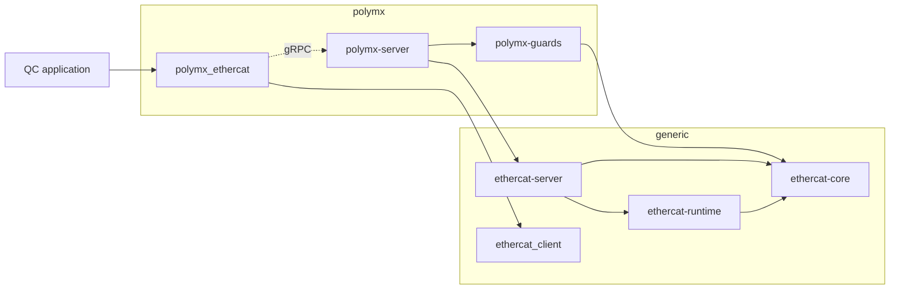
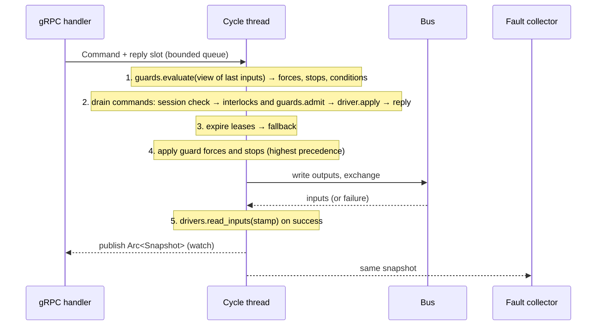

# Splitting the EtherCAT server into a generic part and a PolyMX part

**Status (2026-11-03): proposed. The boundary and the four requirements M1–M4 are decided by the user; the guard
mechanism (G1) and the migration order are proposals awaiting review; open questions in *Open questions*.
The layer structure and crate list are proposed in `layered-refactor.md`, which replaces the three-crate sketch
below.**

## Problem

`nl-polymx-ethercat` is one library for one machine. Its generic parts (EtherCAT cycle, device drivers, sessions and
leases, fault history, diagnostics) are mixed with PolyMX facts: signal names in the wire protocol, machine-specific
enums and helpers in the Python client, rig numbers in the docs, and generic rules tested through the PolyMX machine
file. Other machines should reuse the generic part. PolyMX also needs machine guards: business logic that reacts
within one bus cycle, which today has no place to live.

Scope: the server (Rust), its wire protocol and the Python client. The QC application is out of scope except for
the package it imports.

## Requirements

Musts are verified by the user (2026-11-03). Everything else is an assumption or inferred from the Musts, and stays
unverified until confirmed.

| # | Requirement | Reason (what breaks without it) | Source | Priority | Verified |
|---|---|---|---|---|---|
| M1 | The library is split into a generic part, reusable for other machines, and a PolyMX part that holds all PolyMX knowledge | Other machines are to reuse the generic part (user) | user, 2026-11-03 | must | yes (2026-11-03) |
| M2 | PolyMX machine guards run inside the server process as business logic and can react within one bus cycle | The guards need cycle-time reaction (user). *Inferred:* a guard in a client reacts at gRPC plus Python scheduling latency: 12–20 ms reply gaps and a 560 ms worst scheduling gap were measured in the stationary run (`docs/knowledge/stationary-qualification.md`), against a 10 ms cycle | user, 2026-11-03 | must | yes (2026-11-03) |
| M3 | The guard mechanism is generic: a machine supplies its guards as an extension of the generic server | Reuse for other machines (user) | user, 2026-11-03 | must | yes (2026-11-03) |
| M4 | The split is done inside this repo first, laid out so that each part can move to its own repo (generic, polymx, …) later without restructuring | The parts will become separate repos eventually (user) | user, 2026-11-03 | must | yes (2026-11-03) |
| M5 | The QC application imports the PolyMX EtherCAT client package; the server runs as a separate process | How the QC app is built (user) | user, 2026-11-03 | must | yes (2026-11-03) |
| S1 | No PolyMX name, number or file appears in generic code, tests or docs | *Inferred from M1:* any PolyMX reference left in generic breaks generic when it moves repos (M4) | inferred | should | no |
| S2 | The wire protocol addresses everything by configured name; it contains no machine's names | *Inferred from M1:* machine enums in the protocol force a protocol release per wiring change | inferred | should | no |
| S3 | The generic server runs without any machine extension (generic binary) | *Inferred:* generic tests and guard-less machines need a runnable server | inferred | should | no |
| S4 | Guard code can't do I/O, block or allocate unboundedly in the cycle | *Inferred from M2:* a blocking guard delays the cycle for every device | inferred | should | no |
| A1 | The `0.0.5` contracts carry over unchanged: semver handshake, boot ID, leases and fallback, no command replay, fault lifecycle versus freshness, topology check, `deny_unknown_fields` | They encode measured failures (knowledge docs, stability report) | assumption | assumed must | no |
| C1 | Servo motion and distance sensors can be simulated | Lets the QC app test end to end without the rig. No confirmed need yet | assumption | could | no |
| W1 | More than one bus group, runtime-loadable drivers, scripting languages for guards | No machine needs them | assumption | won't | no |

## Current state

Where PolyMX knowledge sits today:

| Place | PolyMX content |
|---|---|
| Config | `config/machine.toml`, `config/axis.toml`, `config/machine-simulated.toml` (already data, already separable) |
| Wire | `io.proto` enums (`Green`, `FlipperUp`, …); `Sled` service name; fault namespaces `polymx.cycle`, `polymx.drive`, `polymx.supervision` |
| Server | typed services assume one axis (`Devices::axis()`) and one IO-Link master (`distance_sensor_master()`) |
| Python | `LightColor`, `Button`, `Sensor`, `FlipperPosition`, `set_light`, `get_button` in `client.py`; `slide_cycle.py` with axis limits copied from the server (`AXIS_MIN_MM`/`AXIS_MAX_MM`); the debug panel's safe band |
| Tests | generic rules (interlocks, fallback, health) tested through the shipped PolyMX machine file, e.g. `signal_impl.rs` and `main.rs` tests on `FlipperUp`/`FlipperVacuum` |
| Docs | README and guide mix the generic contract with the ring layout and rig measurements |

Structure that blocks in-cycle guards: drivers lock their own state (spin mutexes, atomics, watch channels), gRPC
handlers call driver methods from tokio tasks while the cycle thread calls `update()`, sessions are a separately
locked store, fallback is a closure installed from `main.rs`, and a 5 ms `supervise_outputs` task coordinates
sessions, faults and health under lock-order rules. A guard that must see inputs and act on outputs in the same
cycle would add one more party to that locking. `AxisFallback::ReturnHome` is already refused at load for this
reason: it "needs a state machine across cycles rather than the one call the others are" (`machine.rs`).

## Design

### Boundary

| | **Generic** | **PolyMX** |
|---|---|---|
| Runtime | cycle thread, `Bus` trait with ethercrab and simulated buses, pacer, startup and topology check | — |
| Devices | one driver and profile per **model** (EL1008, EL2008, EL4002, EL6224, ILR1040, iX7NH) | — |
| Machine model | TOML schema: devices, signals, polarity, supervision, fallback, interlocks, health, axes, sensors, guard config tables | `machine.toml`, `axis.toml`, simulated machine file |
| Rules | sessions and leases, fault store, diagnostics, **guard API and built-in guards** | **PolyMX guards** |
| Server | gRPC services, server builder, generic binary | PolyMX binary: the generic server plus PolyMX guards |
| Wire | all protos and `API_VERSION` | none |
| Python | `ethercat_client`: sessions and renewal, signals, axes, sensors, faults, diagnostics, test double, debug panel built from `Describe` | `polymx_ethercat`: names it relies on, lights, flipper, sled, scan cycle, panel presets |
| Tests | rules against small test machines defined in the tests | shipped config validity, PolyMX guards, scan cycle against the simulated server |
| Docs | contract, TOML reference, guard authoring, driver notes | ring layout, rig measurements, deployment |

An iX7NH driver knows CiA-402 and the iX7NH, not the sled. "Sled" is an axis name in `machine.toml`; stopper torque
and limits stay in axis config.

### Repo layout, prepared for the split

```
generic/                       → future repo "ethercat" (name open, Q6)
  Cargo.toml                   own workspace and Cargo.lock
  crates/ethercat-core/        pure: drivers, machine model, sessions, faults, guard API, built-in guards
  crates/ethercat-runtime/     buses (ethercrab, sim), cycle thread, startup
  crates/ethercat-server/      gRPC services, Server builder, generic binary
  proto/  API_VERSION
  client/                      Python package ethercat_client (pyproject.toml)
  docs/
polymx/                        → future repo "polymx-ethercat"
  Cargo.toml                   own workspace and Cargo.lock
  crates/polymx-guards/        depends on ethercat-core only
  crates/polymx-server/        binary: ethercat-server + polymx-guards
  config/                      machine.toml, axis.toml, machine-simulated.toml
  client/                      Python package polymx_ethercat (pyproject.toml)
  docker/  docs/
(root)                         devcontainer, a check script running both parts, a README pointing to both
```

Rules that keep the split mechanical:

1. **Dependencies point one way.** Nothing under `generic/` refers to `polymx/`. A CI check enforces it: a path grep
   plus `cargo metadata` on the generic workspace.
2. **PolyMX uses generic only through its public API.** Cargo dependencies are written as
   `ethercat-server = { path = "../../generic/crates/ethercat-server", version = "0.1" }`. At the split, `path`
   becomes `git` or a registry in one line. Python declares `ethercat_client>=0.1,<0.2` in `pyproject.toml` and
   installs it editable from `../generic/client` in development.
3. **Each part has its own workspace, lock files, version, CI job, Dockerfile and docs.** Nothing at the root is
   needed to build or test either part. The root holds only glue that disappears at the split. rust-analyzer gets
   both workspaces through `linkedProjects`.
4. **Generic tests use generic test machines** (`generic/crates/*/tests/machines/*.toml`), never PolyMX config.
5. **The split itself** is `git filter-repo --path generic/` (and `polymx/`) with history kept, followed by
   rewriting the path dependencies (rule 2).



### Runtime: the cycle thread owns all device state

The cycle thread is the only code that touches drivers, sessions and guards. Handlers send commands over a bounded
queue with a reply slot; reads and streams use the snapshot the cycle publishes.



- **Drivers are pure state machines over byte images**:
  ```rust
  trait Driver {
      fn apply(&mut self, command: DeviceCommand) -> Result<Ack, Reject>;
      fn write_outputs(&mut self, out: &mut [u8]);
      fn read_inputs(&mut self, inputs: &[u8], at: Stamp);
      fn observe(&self) -> DeviceView;
  }
  ```
  No locks. Unit tests need no ethercrab.
- **Steps 1–4 run every tick, whether or not the last exchange succeeded.** That gives A1's "expiry continues during a
  bus stall" by construction.
- **One snapshot per cycle** carries the cycle number and acquisition stamp, so every reading is stamped, not only
  distances (gap AT-10 in `docs/knowledge/ilr-acquisition-timestamps.md`).
- **Command latency stays the same:** a command reaches the wire at the next exchange, as today. A reply can name
  the cycle that carries it, which replaces the desired/transmitted revision bookkeeping.
- **Acyclic work stays outside the cycle:** startup, topology check, diagnostics and SDO uploads keep using ethercrab
  directly, as now.
- **`Bus` trait:** `EthercrabBus` and `SimBus`. `SimBus` runs a plant model per device (digital loopback today, an
  axis and distance model if C1 is confirmed), so the real drivers are the code under simulation.

### Guards

A guard is machine logic that runs in the cycle thread. It sees the current view and can refuse commands, force
outputs, stop axes and raise conditions.

```rust
pub trait Guard: Send + 'static {
    /// Typed configuration from the machine file's `[guard.<name>]` table (deny_unknown_fields).
    type Config: DeserializeOwned;

    /// Called once at startup. Resolves signal, axis and sensor names to typed handles.
    /// An unknown or mistyped name is a startup error, listed with every other one.
    fn bind(config: Self::Config, binder: &mut Binder) -> Result<Self, BindError> where Self: Sized;

    /// Every tick, before commands are applied.
    fn evaluate(&mut self, view: &View, actions: &mut Actions);

    /// Every command, before it reaches a driver. Refusals name the guard and a reason.
    fn admit(&self, view: &View, command: &Command) -> Admission { Admission::Allow }
}
```

- **Actions:** `force(output, level)`, `stop(axis)`, `raise(condition)`, `clear(condition)`. A force or stop holds
  only while the guard keeps asserting it. A guard that latches keeps that latch in its own state, so how a latch is
  reset is part of the guard (open: Q2).
- **Precedence:** guard force > fallback > client command. A command against a forced output is refused through
  `admit` with the guard's reason, so the client can tell why.
- **Visibility:** `Describe` lists each guard and the names it binds. The snapshot lists asserted forces and stops.
  Conditions go to the fault store under namespace `guard.<name>`. Refusals return `FAILED_PRECONDITION` with the
  guard name in structured error details.
- **Built-in guards** in generic implement what the machine file declares today: `mutually_exclusive` interlocks and
  the `[health]` output. They are configured from TOML as now. Machine-specific guards are Rust types in the
  machine's crate. `AxisFallback::ReturnHome` becomes possible as a cross-cycle state machine.
- **Bounded cost:** guards receive only `View` and `Actions` (S4). The runtime measures guard time per tick and
  reports it in bus status.
- **Composition:** the PolyMX server binary is the generic server plus its guard list:
  ```rust
  fn main() -> ExitCode {
      ethercat_server::Server::from_args()
          .guard::<polymx_guards::FlipperStroke>("flipper_stroke")
          .guard::<polymx_guards::SledClamp>("sled_clamp")
          .run()
  }
  ```
  Guard names and types here are placeholders until the PolyMX guard list is known (Q1). A guard listed in the binary
  without a `[guard.<name>]` table, or a table without a registered guard, is a startup error.

#### How guards are expressed (options)

| Option | Fits | Costs |
|---|---|---|
| **G1 Rust trait in the machine's crate, compiled into a per-machine binary** (proposed) | Any logic, including cross-cycle state machines; type-checked; no interpreter in the cycle; unit-testable as pure code | A server build and image per machine; guard authors write Rust |
| G2 Declarative rules in TOML, interpreted by the generic server | One generic binary; config-only changes | Grows into a small, badly designed language as rules get stateful; hard to test |
| G3 Embedded script (Rhai, Lua, WASM) loaded at start | One generic binary; logic outside the build | Interpreter and allocation in the cycle; weaker typing; a second language to maintain |
| G4 Separate guard process | Isolation | Can't react within a cycle: fails M2 |

Proposal: G1, with built-in guards for the patterns the TOML already declares (interlocks, health). This keeps the
declarative cases declarative without adding a rule language.

### Wire protocol

Generic protos only; PolyMX defines none.

| Service | Addressed by | Change from `0.0.5` |
|---|---|---|
| `Session` | session ID | `Hello`, `OpenSession`, `Heartbeat`, `Release`, `Close`, `ResetHealth`, moved out of `Bus` |
| `Machine` | — | `Describe` returns the full model: signals, axes with limits and units, sensors, groups, guards |
| `Signal` | name | as now; replaces `Io`, which is removed |
| `Axis` | name | replaces `Sled` |
| `Distance` | name | replaces sensor index |
| `Bus` | — | status and `WatchStatus` only |
| `Faults`, `Diagnostics` | — | namespaces `ethercat.*` and `guard.<name>`; the machine name from `machine = "…"` goes in the snapshot header |

This is a breaking API change (`0.1.0`).

### Python packages

- **`ethercat_client`** (generic): session and renewal, `signal(name)`, `axis(name)`, `distance(name)`, faults,
  diagnostics, `ethercat_client.testing`, and the debug panel built from `Describe` (groups, axes, sensors, guards).
- **`polymx_ethercat`** (PolyMX): declares the names it relies on and checks them against `Describe` on connect,
  failing with a list of every missing or mistyped name, the way the topology check does. `machine.toml` stays the
  only source of names: no generated code, no copied enums. Provides lights, flipper, sled (axis `Sled`), the scan
  cycle and panel presets (safe band, cycle defaults). Axis limits come from `Describe`.

The QC application depends only on `polymx_ethercat` (M5) and reaches generic types through it.

### Testing

| Part | What is tested | How |
|---|---|---|
| `ethercat-core` | drivers, sessions, faults, built-in guards | pure unit tests on byte images and views |
| `ethercat-runtime` / `-server` | cycle ordering, precedence, RPC contract | `SimBus` with test machines |
| `polymx-guards` | each guard's rules | pure unit tests with a fake `View` |
| `polymx-server` | shipped config binds every guard and name | start against `machine-simulated.toml` |
| `polymx_ethercat` | name check, scan cycle | against the simulated PolyMX server |

### Versioning

- Generic keeps the semver API handshake (`API_VERSION`) and its own package versions.
- PolyMX has its own version; its server reports the generic version it was built with in its build identity.
- `polymx_ethercat` pins a range of `ethercat_client`; the QC app pins `polymx_ethercat`.

## Migration

Each phase is several commits and leaves checks passing.

| Phase | Content | Wire change |
|---|---|---|
| P1 | Move files into `generic/` and `polymx/`, two workspaces and pyprojects, generic test machines, boundary CI check. No behavior change | none |
| P2 | Name-addressed protocol and full `Describe`; remove `Io`; split the Python client; QC app moves to `polymx_ethercat` | `0.1.0` |
| P3 | Cycle-owned state: command queue and snapshot, one subsystem at a time (digital IO, analog, axis, sensors, sessions) | none |
| P4 | Guard API; interlocks and health become built-in guards | additive |
| P5 | `polymx-guards`, `polymx-server` binary; deployment switches image | additive |
| P6 | `SimBus` axis and distance plant models (if C1 is confirmed; earlier if QC tests need it) | none |
| P7 | Repo split | none |

P4 comes after P3. Guards on the current shared-state structure would add a fourth party to the locking described
in *Current state*, and that work would be thrown away in P3. If PolyMX guards are needed before P3 ends, P3 can
first convert the subsystems the guards touch.

## Open questions

1. **Which PolyMX guards are needed, and what does each do?** This decides the guard API's first real users and
   whether `View`/`Actions` cover them.
2. **Guard latch and reset:** should a tripped guard latch until an explicit reset (generic `ResetGuard(name)` RPC, or
   an input such as the Reset button), or act only while its condition holds?
3. **A guard that panics:** stop the process (the ESC watchdogs take the outputs to their safe state, and Compose
   restarts the server), or disable that guard and raise a condition? Proposal: stop the process. A panic is a
   programmer error.
4. **How many clients control outputs at the same time?** If it's one controller plus read-only observers, the
   per-output last-writer ownership model can shrink to one control lease.
5. **Is there a reason against a bidirectional session stream?** It would allow immediate fallback on disconnect
   and ordered receipts without a separate heartbeat channel.
6. **Names:** generic repo and crates (`ethercat-*` above), Python packages `ethercat_client` and
   `polymx_ethercat`.
7. **Fault history scale:** what sets 4096 identities with 12 KiB each? A smaller detail cap would allow a unary
   snapshot instead of a stream.

## Decisions

| Date | Decision | By |
|---|---|---|
| 2026-11-03 | Split into generic and PolyMX parts (M1) | user |
| 2026-11-03 | Machine guards run in the server as a generic extension mechanism, reacting within one cycle (M2, M3) | user |
| 2026-11-03 | Split inside this repo first, prepared for separate repos (M4) | user |
| 2026-11-03 | QC app imports the PolyMX client; server is a separate process (M5) | user |
