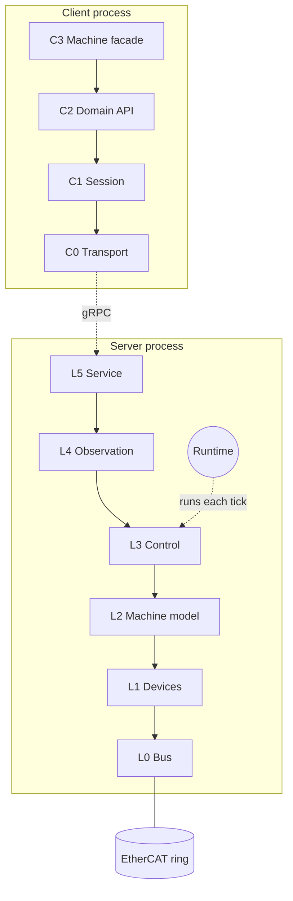
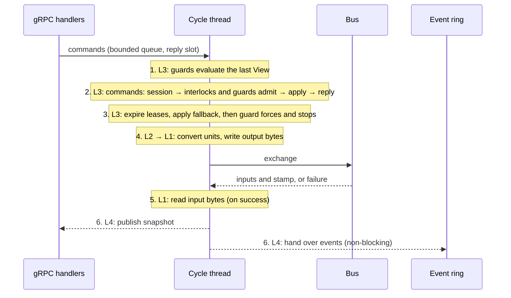
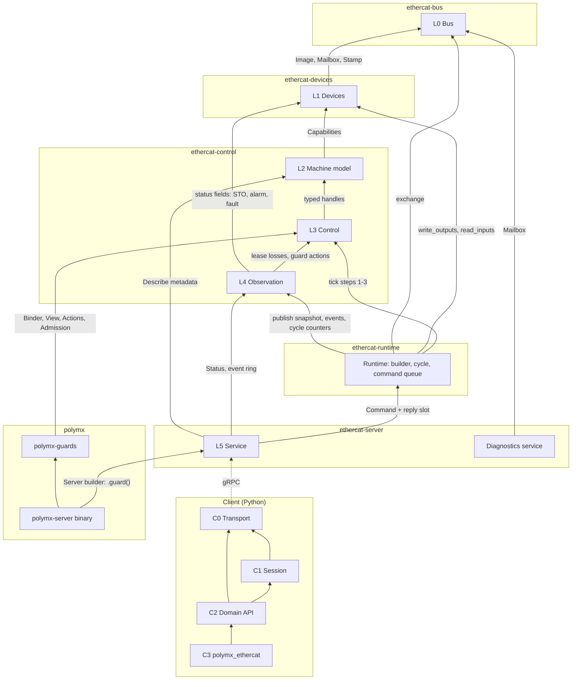

# Proposal: a layered EtherCAT server with a generic/machine split

**Status (2026-11-03): proposal.** It gives the structure for the split decided in `generic-polymx-split.md`
(requirements M1–M5) and replaces that document's three-crate sketch. Reviewed the same day; see *Review findings*.

## The architecture in one page



Three ideas carry the design:

1. **Layers with one job each.** Each layer knows only the layer below it and hands the layer above a narrower,
   more meaningful view: bytes become device state, device state becomes named signals in machine units, named
   signals become commands that are allowed or refused.
2. **One thread owns all state.** The runtime's cycle thread runs the layers in a fixed order every tick. gRPC
   handlers reach it only through a command queue and read only the snapshot it publishes. No layer below the
   service locks anything.
3. **A small core with five extension points.** Anything that decides what reaches the hardware is plain code in the
   core, or a guard when it differs per machine. Observation is a typed status and one event stream, not a
   subsystem. A machine adds configuration, guards, its own drivers if needed, and a client facade, and nothing else.

| Layer | Job |
|---|---|
| **L0 Bus** | Exchange process data with a known ring; give mailbox access to each device |
| **L1 Devices** | One driver per device model: bytes ↔ device state |
| **L2 Machine model** | Names → device channels, in machine units |
| **L3 Control** | Decide what may be applied; what happens when a client goes silent |
| **L4 Observation** | Publish what is true now, as a snapshot and a stream of events |
| **L5 Service** | gRPC |
| **Runtime** | Startup order, the cycle thread, the command queue |
| **C0–C3** | Client: transport, session, domain API, machine facade |

## Generic and machine parts

| Layer | Generic provides | A machine adds |
|---|---|---|
| L0 Bus | ethercrab bus, `SimBus` with plant models, topology check | — |
| L1 Devices | drivers and profiles for supported models | a driver for a model generic lacks (a new model normally goes to generic) |
| L2 Machine model | TOML schema and validation | `machine.toml`, `axis.toml`, simulated machine file |
| L3 Control | sessions, leases, fallback, the guard engine, built-in guards (interlocks, health) | its guards and their `[guard.<name>]` config |
| L4 Observation | snapshot with typed status and counters, event stream, diagnostics | — (guard conditions and events appear under `guard.<name>`) |
| L5 Service | all services and protos | — |
| Runtime | cycle, startup, server builder, generic binary | its binary: the builder plus its guards |
| C0–C2 | `ethercat_client` | — |
| C3 | — | `polymx_ethercat` |

A machine's server binary is only composition:

```rust
fn main() -> ExitCode {
    ethercat_server::Server::from_args()
        .guard("flipper_stroke", polymx_guards::flipper_stroke)   // placeholder names; a bind function
        .run()
}
```

## Core or extension

Every feature the server and client have today stays, unless a separate decision drops it. The question is only
where it lives. One rule decides that: **does the feature decide what reaches the hardware?**

| Answer | Where it lives | Examples |
|---|---|---|
| Yes, the same for every machine | **Core**, as plain code | session model, lease and fallback, axis state machine, pacing |
| Yes, different per machine | **Guard** | PolyMX guards; interlocks and health as built-in guards |
| No, it only observes | **Core** status and events, or a **service** | counters, conditions, events; diagnostics |
| A different environment, not a different feature | **Implementation of a core trait** | ethercrab or `SimBus`, plant models |

Why not make everything an overlay:

- **Safety-relevant behavior would be spread out.** Lease expiry, fallback and interlocks need a fixed order within
  the tick. Split over independent overlays, that order becomes an implicit contract between modules: the hidden
  coupling today's lock-order rules already show.
- **Every extension point is a stable interface to maintain.** A pacer or version-policy trait with one
  implementation costs more than it saves.
- **Optional features multiply tests.** Features PolyMX needs are always on. "Extension" is a way to structure code,
  not a deployment switch.

Why not integrate everything:

- **The machine split needs extension points anyway** (M3). If generic's own built-ins use them (interlocks and
  health as guards), they are exercised from the first day instead of designed in a vacuum.

Observation is most of today's complexity: the fault store, freshness, batched snapshots, edge latches in drivers,
and lock-order rules between sessions and faults. It doesn't need an extension point; it needs less machinery. L4
publishes typed counters in the status the cycle already sends, plus one bounded event stream (see *L4
Observation*).

Of the 35 features beyond the bare core, about 28 *could* be extensions. 13 should be, and they sit on five
extension points. The debug panel is an application on the client. The rest are plain core code. The full list is
in *Where every feature lives*.

## The five extension points

| Extension point | Where | Users |
|---|---|---|
| **Guard** (closures, or a struct adapted to closures) | L3, in the cycle | interlocks, health output, machine guards |
| **Driver registration** | L1 | generic models, machine-specific models |
| **Bus and Plant** | L0 | ethercrab, `SimBus`, Windows TX/RX, simulated axis and sensors |
| **Service registration** | L5 | diagnostics, `GetSessions`, reflection |
| **Client interceptor and session events** | C1/C2 | mutation tracking, re-registration, timing ring, loss notifications |

Rules for all of them:

- **Static composition.** Everything is wired through the server builder at compile time. No dynamic loading, no
  feature flags.
- **Bounded cost in the cycle.** Guards get a read-only `View` and an `Actions` sink, no I/O. The runtime measures
  their time per tick.
- **The runtime fixes the order.** Extensions never decide when they run relative to each other (see *The tick*).

## The layers

Each layer is described by its job, its interface, its core, and what attaches to it.

### L0 Bus

Opens the NIC, discovers the ring, compares it with the declared models (listing every mismatch, with the
discovered ring logged), walks the devices to OP and exchanges process data.

```rust
trait Bus {
    fn exchange(&mut self) -> Result<Stamp, ExchangeError>;
    fn image(&mut self, slot: Slot) -> Image<'_>;   // { inputs: &[u8], outputs: &mut [u8] }
    fn mailbox(&self, slot: Slot) -> Mailbox;          // async SDO and register access, outside the cycle
}
```

- **Core:** the trait, ethercrab bus, topology check, digital-loopback `SimBus`, exchange-failure policy (the retry
  budget derived from the ESC watchdog).
- **Attaches:** Windows TX/RX as a `Bus`; axis and sensor plant models as `Plant`s in `SimBus`; diagnostics use
  `Mailbox` through a service.
- **Must not know:** what any byte means.

### L1 Devices

```rust
trait Driver {
    fn configure(&self, mailbox: &Mailbox) -> impl Future<Output = Result<(), ConfigError>>;
    fn write_outputs(&mut self, out: &mut [u8]);
    fn read_inputs(&mut self, inputs: &[u8], at: Stamp);
    fn capabilities(&mut self) -> Capabilities<'_>;   // DigitalOut, Axis, ... in device units
}
```

| Model | Core |
|---|---|
| EL1008 | 1 byte → 8 bools |
| EL2008 | 8 bools → 1 byte |
| EL4002 | 2 × i16 counts → bytes |
| EL6224 + ILR1040 | port configuration SDOs; 6 bytes per port → distance, valid, quality |
| iX7NH | CiA-402 enable sequence, home, profile-position move, halt, hold/resume; position, state, fault, STO and alarm code as status fields |

- **Core:** decoding and encoding, the axis state machine, profiles as identity plus SDO init list (including the
  homing speeds, as data).
- **Attaches:** machine-specific drivers through registration. Status fields (STO, alarm, fault) are published in
  the snapshot. L4 turns them into conditions, not driver code. The cycle sees every tick, so drivers need no edge
  latches.
- **Must not know:** names, machines, sessions. No locks: the cycle thread owns every driver.
- **Later: ESI device descriptions (Should; a strong want, user, 2026-11-04; not in this refactor).** Take identity
  (vendor ID, product code, revision) and the PDO layout from the vendor's ESI XML instead of hand-written profiles
  and driver code; this is what a data-driven generic terminal driver needs. ESI doesn't cover device alarm codes,
  severity, our own SDO choices or IO-Link sensors (the ILR1040 has an IODD), so profiles keep those and sit on top
  of ESI. Use a small own reader (`quick-xml` + serde, identity and PDOs only), not `ethercat-esi`: released last in
  2020, fails on some vendors' files (issue #1, fix PRs unmerged since 2023), pins `serde-xml-rs` 0.4. Open: check
  the real EL2008 and iX7NH ESI files for error texts, extract at build time or at runtime, revision handling, and
  the vendors' licence terms for keeping their XML in the repo.

### L2 Machine model

```toml
[input.Start]         device = 1, channel = 0
[output.FlipperUp]    device = 3, channel = 3
[analog.VisionLight1] device = 6, channel = 0, curve = "gamma"
[axis.Sled]           device = 8               # units and limits from axis.toml
[sensor.Ilr1]         device = 7, port = 0
```

- **Core:** load and validate (`deny_unknown_fields`); bind names to device capabilities; polarity; per-mille ↔
  counts (linear and gamma); mm ↔ UU with limits; `group` as presentation metadata passed through `Describe`.
- **Hands upward:** typed handles in machine units: `Signal<bool>`, `Signal<PerMille>`, `AxisHandle` (mm),
  `SensorHandle`. L3 and guards never see counts, UU or polarity.
- **Must not know:** who may command what. Supervision and fallback declarations are L3 configuration.

### L3 Control

L3 decides what may be applied and what happens when a client goes silent. It has three parts: the session model,
fallback and guards.

- **Core:** the session model and its leases; generations and boot ID; idle-registration TTL and capacity bounds;
  close semantics; fallback; the guard engine.
- **Attaches:** guards.
- **Must not know:** gRPC or wire formats.

#### Session model

The session model is one open choice: a single control lease, or today's per-output last-writer ownership with
receipts (`generic-polymx-split.md`, question 4). Either way it is core: it *is* the control model, not an add-on.

#### Fallback: declared data

What a supervised output does when its owner goes silent is declared per output in the machine file, as today:
`fallback = false | 0 | "hold"`, and `on_supervision_loss = "stop"` for an axis. L3 applies it directly when a lease
expires; nothing is installed as a closure.

Fallback stays data, not code:

- **It can be inspected.** `Describe`, the machine file and the panel show what each output does when nobody is
  watching. A lambda would hide the answer to that question.
- **It can be validated at load:** against `supervised`, against the health output, and against interlocks.
- **Guards cover the dynamic cases.** `View` carries lease-loss events, so a guard can react to a loss with any logic,
  including sequences across cycles such as `ReturnHome`. A guard force takes precedence over fallback, so the
  declared fallback stays the simple, visible default and the guard handles the exception.

#### Guards: closures in the engine

The engine stores each guard as up to two closures, and knows no other representation:

- **evaluate** runs every tick on the last `View` and may act through `Actions`;
- **admit** runs for every command and may refuse it with a reason.

A guard is registered with a bind function that runs once at startup. It reads the guard's `[guard.<name>]` config
table (`deny_unknown_fields`), resolves the names it needs, and returns the closures. The resolved handles and any
state live in the closures.

```rust
server.guard("flipper_stroke", |binder: &mut Binder, config: FlipperConfig| {
    let up = binder.output("FlipperUp")?;          // an unknown or mistyped name fails startup here
    let at_down = binder.input("FlipperAtDown")?;
    Ok(Guard::new()
        .admit(move |view, command| {
            if command.raises(up) && !view.input(at_down) {
                Admission::Refuse("flipper must be down before it is raised")
            } else {
                Admission::Allow
            }
        }))
})
```

Two ways to write a guard, one engine:

| Form | Fits | How it reaches the engine |
|---|---|---|
| **Closures** | small rules; one hook; state used by one hook | directly |
| **Struct with a small trait** | state shared by `evaluate` and `admit` (a latch); state shown in the snapshot or `Describe`; reset through an RPC | an adapter turns it into the same closures |

Two closures can't both mutate the same captured variable without a `Cell`. The cycle thread is single-threaded, so a
`Cell` is cheap and safe, but a guard with a latch both hooks use reads better as a struct.

Built-in guards are closures generated at load. Each `[[interlock]] kind = "mutually_exclusive"` becomes an `admit`
closure. The health output (with its reset and latching) is a built-in guard that reads lease-loss events from
`View`. Machine guards are written in the machine's crate, in either form.

Guard rules:

- `bind` resolves names at startup; every unknown or mistyped name is listed in one startup error.
- `Actions` is the only way a guard affects the machine: force an output, stop an axis, raise or clear a condition.
- A force holds only while the guard keeps asserting it. A latch is the guard's own state.
- Precedence is guard force > fallback > client command.
- A command against a forced output is refused through `admit`, naming the guard.

### L4 Observation

L4 publishes what is true now and what happened, over the same gRPC server as everything else. It uses no metrics
library. The set of numbers is small and known in advance, and there is one consumer, the client, so typed protocol
fields are simpler than a generic registry. Prometheus and OTLP were considered and judged too heavy (user,
2026-11-03).

- **Status.** The snapshot the cycle publishes every tick carries:
  - boot ID, cycle number and acquisition stamp
  - exchange failures and overruns since boot
  - last and maximum cycle time
  - occurrence counts per condition since boot (`condition_counts`)
  - the active conditions

  The cycle thread updates these as plain fields: no registry, no atomics shared with other threads. Counters are
  cumulative since boot, so a client that reconnects loses no counts. Every reading carries the snapshot's stamp,
  not only distances.
- **Conditions.** L4 derives them each tick from driver status fields (STO, alarm code, fault bit), lease losses
  and guard actions.
- **Events.** Occurrences, clears, refusals and details (codes, raw bytes, text) are structured events. The cycle
  thread hands each one over with a non-blocking send and never formats. An event task keeps a bounded ring (for
  example 4,096 events) with sequence numbers. `WatchEvents(from_seq)` replays what is still in the ring, then
  streams live. When a client asks for events that have left the ring, or falls behind, `missed` says how many, so
  a gap is never silent.
- **Recording.** Events are recorded with `tracing`, and a small Layer copies them into the ring, so `docker logs`
  and the stream show the same events. This is optional; a plain function call works too.
- **Diagnostics.** On-demand reads (AL and link registers, SDO uploads, watchdog inspection, labels) go through L0's
  `Mailbox`, as a registered service.

```proto
service Telemetry {
  rpc GetStatus(Empty) returns (Status);
  rpc WatchStatus(Empty) returns (stream Status);
  rpc WatchEvents(EventsRequest) returns (stream EventBatch);
}
message Status {
  string boot_id = 1;
  uint64 cycle = 2;
  uint64 exchange_failures_total = 3;
  uint64 overruns_total = 4;
  uint32 cycle_time_last_us = 5;
  uint32 cycle_time_max_us = 6;
  map<string, uint64> condition_counts = 7;
  repeated Condition active = 8;
}
message EventsRequest { uint64 from_seq = 1; }
message EventBatch { repeated Event events = 1; uint64 missed = 2; }
message Event {
  uint64 seq = 1;
  int64 at_ms = 2;
  Level level = 3;
  string source = 4;          // "drive.sled", "guard.flipper_stroke", "bus"
  string message = 5;
  optional uint32 code = 6;
  bytes raw = 7;
  map<string, string> fields = 8;
}
```

What this gives up:

- A new metric is a proto field.
- Generic tools such as Grafana need a forwarder.
- There are no percentiles beyond last and max, unless a fixed-bucket histogram field is added.
- History beyond the ring belongs to whoever consumes the stream: the panel, a file, or a ROS `/diagnostics`
  forwarder in the machine part.

> **Note (2026-11-03): a simpler starting point, not decided.** What the simplest diagnostics and health system
> would be if none existed, ignoring today's requirements. The design above is where it grows to.
>
> **Health is a list of current problems, recomputed from the machine state every tick; history is the log.**
> Nothing is stored, acknowledged or aged. Today's system records conditions and then manages their lifecycle
> (active, cleared, stale, counted, retained), and most of its complexity is keeping that record in step with
> reality. Derived from the current state, there is nothing to keep in step.
>
> ```rust
> struct Problem { source: String, message: String, since: Instant }
>
> // each part reports what is wrong with it right now
> trait Health { fn problems(&self, out: &mut Vec<(String, String)>); }
> ```
>
> | Part | Reports a problem when |
> |---|---|
> | Bus | exchanges are failing, or the ring isn't in OP |
> | Each driver | the device left OP; the drive is faulted (with its alarm code); STO is open; a sensor reading is invalid |
> | Sessions | an output fell back and nobody has reclaimed it |
> | Guards | a guard is forcing or refusing something |
>
> An empty list means healthy. A problem that is gone isn't in the list: there is no "cleared" state, and nothing can
> stay stuck as active.
>
> Three small pieces around it:
>
> 1. **`since`.** The runtime compares this tick's list with the last one, by source and message. A problem keeps its
>    first-seen time while it lasts.
> 2. **History.** One log line when a problem appears, one when it goes (`WARN drive.sled: faulted, alarm 0x2310`,
>    `INFO drive.sled: recovered after 4.2 s`), to `docker logs`. No history API, no store.
> 3. **Delivery.** The problems ride along in the status the server already streams. On the client,
>    `client.status().problems`, and `client.healthy` is `not problems`.
>
>    ```proto
>    message Problem { string source = 1; string message = 2; int64 since_ms = 3; }
>    message Status  { string boot_id = 1; uint64 cycle = 2; repeated Problem problems = 3; }
>    ```
>
> Optional: a health lamp is one line (`health_output = problems.is_empty()`). Raw device details (AL status, link
> counters) can be one on-demand `Diagnose(device)` RPC returning key/value pairs, or logged at startup until
> someone needs them. Estimated size: 100–200 lines across server and client.
>
> It handles two edge cases for free:
>
> - **Stale data.** If the bus stops exchanging, the bus problem is in the list, and that marks every device-derived
>   problem below it as suspect, without a freshness model.
> - **Restart.** There is no stored state to recover. After a restart the list is whatever is true now, and
>   `boot_id` tells the client it is a new server.
>
> What it gives up, and when to add each back:
>
> | Missing | Effect | Add back when someone needs | Step toward the design above |
> |---|---|---|---|
> | Counts | "how often?" needs `grep` on the log | how often, from the API | a counter per source in `Status` |
> | Short-lived problems in the API | a problem lasting one tick may never reach a slow client (it is still logged) | transients, remotely | the bounded event stream with sequence numbers |
> | History over the API | only via logs | history without log access | the event stream plus a consumer that keeps it |
> | Explicit "unknown" vs "fine" per device | only the bus problem marks everything below as suspect | per device, which data is unsure | a `stale` flag per source |
>
> Starting here and growing toward the design above only when one of these needs comes up is an option.

### L5 Service

Maps protobuf to L3 commands and L4 observations; does the version handshake and maps errors.

| Service | RPCs |
|---|---|
| `Session` | `Hello`, `Open`, `Renew`, `Release`, `Close`, `ResetHealth` |
| `Machine` | `Describe`: signals, axes with limits and units, sensors, groups, guards |
| `Signal` | `Get`, `Set`, `Watch` (replaces `Io`) |
| `Axis` | `Home`, `Move`, `Stop`, `Hold`, `Resume`, `Watch` (by name; replaces `Sled`) |
| `Distance` | `Get`, `Watch` (by name) |
| `Telemetry` | `GetStatus`, `WatchStatus`, `WatchEvents` (replaces `Bus` status and `Faults`) |
| registered | `Diagnostics`, `GetSessions`, reflection |

- **Core:** the services above and the semver handshake (including the stable-major rules, as a plain function).
- **Must not know:** device bytes, locking, timing.

### Runtime

The composition root: startup order, the server builder, the cycle thread with an absolute-deadline pacer
(sleep, then spin for the last interval; overruns counted), the bounded command queue, guard timing per tick.

### Client

| Layer | Core | Attaches |
|---|---|---|
| **C0 Transport** | channel and keepalive settings, generated stubs, semver handshake, session-token interceptor | — |
| **C1 Session** | registration, renewal thread, supervision snapshot, release and close (`CloseResult`) | through session events: heartbeat timing ring, loss-notification queue, re-registration (`ensure_session`) |
| **C2 Domain API** | `signal(name)`, `axis(name)`, `distance(name)`, `status()`/`watch_status()`, `watch_events(from_seq)` (reports `missed`), diagnostics, `describe()`; generated or immutable value types; `testing` | through the call interceptor: pending-mutation cap and uncertainty tracking |
| **C3 Machine facade** | the machine's names, checked against `Describe` at connect; its procedures | PolyMX: lights, flipper, sled, scan cycle, panel presets |

The debug panel is an application on C2, built only from `Describe`.

## The tick

The runtime runs every tick in this order. Steps 1–3 also run after a failed exchange, so lease expiry and fallback
don't depend on bus progress.



A command reaches the wire at the next exchange, as today. Its reply can name the cycle that carries it.

## Interfaces between the layers

What each layer offers and who uses it. *Not specified* marks an interface this proposal describes only in prose or
not at all.

| Offered by | Interface | Used by | Specified |
|---|---|---|---|
| L0 Bus | `Bus { exchange, image, mailbox }`; types `Slot`, `Stamp`, `Image`, `Mailbox`, `ExchangeError` | L1, runtime, diagnostics service | yes |
| L0 Bus | `Plant`, for simulated devices in `SimBus` | `SimBus` | not specified |
| L0 Bus | open, topology check, walk to OP | runtime, at startup | not specified |
| L1 Devices | `Driver { configure, write_outputs, read_inputs, capabilities }` | runtime, L2 | yes |
| L1 Devices | driver registration (model → driver) | runtime, machine binary | not specified |
| L1 Devices | status fields: STO, alarm code, fault bit | L4 | not specified: through `Capabilities` or separately |
| L2 Machine model | load and validate; handles `Signal<bool>`, `Signal<PerMille>`, `AxisHandle`, `SensorHandle` in machine units | L3, guards (through `Binder`) | types only; no methods |
| L2 Machine model | metadata: groups, units, limits | L5 (`Describe`) | not specified |
| L3 Control | guard API: `Binder`, `View`, `Actions`, `Guard::new().evaluate(..).admit(..)`, `Admission` | guards | sketched |
| L3 Control | `Command` and its reply: session, signal and axis commands | runtime (from L5 through the queue) | not specified; depends on the session model |
| L3 Control | lease losses, guard actions | L4 | not specified |
| L4 Observation | `Status`, event ring, `WatchEvents(from_seq)` with `missed` | L5 | proto only; the cycle-to-ring handover is prose |
| Runtime | `Server::from_args().guard(..).run()`, service registration | machine binary | sketched |
| Runtime | bounded command queue with reply slot; published snapshot | L5 | not specified |
| L5 Service | `Session`, `Machine`, `Signal`, `Axis`, `Distance`, `Telemetry`; semver handshake | C0 over gRPC | services and RPC names |
| C0–C2 | see *Client* | C3, QC app, debug panel | names only |

An arrow means "calls or reads the interface of"; each box is a crate.



What the graph shows:

- **Only L0 → L1 → L2 → L3 is a strict stack.** The runtime calls four layers directly, L5 uses L2, L4 and the
  runtime, and L4 reads both L1 and L3. L4 is a sibling of the cycle core, not a layer above L3.
- **The least specified interfaces carry the most weight.** `Command`, `View`, `Actions` and the snapshot handle sit
  around L3 and the runtime; only `Bus` and `Driver`, at the bottom, are written out.
- **The guard API is the only Rust surface the machine part uses.** Everything else on the PolyMX side goes through
  the builder or over gRPC, so `Binder`, `View`, `Actions` and `Admission` are what must stay stable after the repo
  split.

## Where every feature lives

All 35 features beyond the bare core, by home.

| Feature | Layer | Home |
|---|---|---|
| Discovered-ring startup log | L0 | core |
| Retry budget from the ESC watchdog | L0 | core |
| Windows TX/RX | L0 | `Bus` implementation |
| Simulated axis and sensors | L0 | `Plant` |
| Watchdog register inspection | L0/L4 | diagnostics service |
| On-demand diagnostics: reads, labels, service | L4/L5 | service registration |
| Hold/resume | L1 | core (axis state machine) |
| Sensor quality grades | L1 | core (driver decoding) |
| Homing speeds and extra SDOs | L1 | core (profile data) |
| STO, alarm code, fault bit → conditions | L1/L4 | core: L4 derives conditions from driver status fields |
| Signal groups | L2 | core (metadata) |
| Gamma curves | L2 | core |
| Session model (single lease or per-output ownership with receipts) | L3 | core |
| Generations and boot-ID checks | L3 | core |
| Idle TTL and session capacity bounds | L3 | core |
| `hold` fallback | L3 | core |
| Close semantics and `CloseResult` | L3/C1 | core |
| Interlocks | L3 | built-in guard |
| Health output, reset and latching | L3 | built-in guard |
| Guard-raised conditions | L3 | `Actions` |
| Acquisition timestamps on every reading | L4 | core (snapshot) |
| Fault history: counts, cleared retention, events | L4 | core: `condition_counts` in status; occurrences and clears as events in the bounded ring |
| Freshness, epochs, sequences | L4 | core, simplified: snapshot stamp, boot ID, event sequence numbers |
| History capacity, batched snapshots, reporting health | L4 | dropped: the bounded event ring reports `missed` |
| Bus counters | L4 | core: typed status fields |
| `GetSessions` | L5 | service registration |
| Reflection | L5 | service registration |
| Stable-major semver rules | L5 | core |
| Sleep-then-spin pacer | runtime | core |
| Per-tick guard timing | runtime | core |
| Client pending-mutation cap and uncertainty | C2 | call interceptor |
| Client re-registration | C1 | session events |
| Client heartbeat timing ring | C1 | session events |
| Client loss-notification queue | C1 | session events |
| Debug panel | client | application on C2 |

## Crates and packages

One crate per layer group, so the compiler enforces the dependency direction, and a guard author depends on L3
without pulling in gRPC or ethercrab.

```
generic/
  crates/ethercat-bus/        L0          depends on: ethercrab
  crates/ethercat-devices/    L1          depends on: ethercat-bus (Image, Mailbox)
  crates/ethercat-control/    L2, L3, L4  depends on: ethercat-devices
  crates/ethercat-runtime/    runtime     depends on: the three above
  crates/ethercat-server/     L5          depends on: ethercat-runtime, tonic
  proto/  API_VERSION
  client/ethercat_client/     C0–C2       transport/, session/, api/ subpackages
polymx/
  crates/polymx-guards/       guards      depends on: ethercat-control only
  crates/polymx-server/       binary      depends on: ethercat-server, polymx-guards
  config/
  client/polymx_ethercat/     C3          depends on: ethercat_client
```

L2–L4 share a crate because they share the `View`, snapshot and event types and change together. They stay separate
modules inside it.

The repo-split rules from `generic-polymx-split.md` apply:

- dependencies point one way, checked in CI
- each part has its own workspace, lock files, version, CI job and docs
- path dependencies also carry a version, so each becomes a git or registry dependency by changing one line
- generic tests use generic test machines

## Preparing the repo split

The rules above hold only once nothing in the repo ties the two parts together. Today these do (paths relative to
the repo root):

| Tie | Where | Why it blocks the split |
|---|---|---|
| Generic tests read PolyMX config | `server/lib/src/machine.rs`, `drivers/ix7nh.rs`, `diagnostic_request.rs`, `server/src/signal_impl.rs`, `server/src/main.rs` (`include_str!` and `read_to_string` of `config/*.toml`) | breaks the one-way rule after the move; doesn't compile after the split |
| PolyMX ring in generic tests | `polymx_ring()` and `polymx_declared()` in `server/lib/src/ethercat.rs` | PolyMX layout as generic test data |
| Binary defaults to PolyMX config | `--machine` and `--axis-config` defaults in `server/src/main.rs` | the generic binary assumes a `config/` only PolyMX has |
| Client build reaches into the server | `client/setup.py`: protos from `../server/proto`; source identity hashes `config/*.toml`, `server/**`, `rust-toolchain.toml` | the generic client's identity includes PolyMX config, and the paths disappear |
| Python end-to-end tests use shipped config | 7 files in `client/tests/`; `simulation_soak.py`, `client_contract_check.py`, `status_consumer_check.py` | as for the Rust tests |
| One version for everything | `0.0.5` in both `Cargo.toml` files, `pyproject.toml`, image tag and compose file | the parts can't be released apart |
| One check script, CI job and Dockerfile | `scripts/check_release.sh`, `.github/workflows/stability.yml`, `docker/server/Dockerfile` (copies `config/` into the image) | neither part builds or tests alone |
| Tooling at the root | `rust-toolchain.toml`, `.vscode/settings.json` (`linkedProjects`), devcontainer `pip install -e client` | each future repo needs its own |
| Mixed docs | `docs/guide/` (generic reference) next to `DEPLOYMENT.md`, `STABILITY_REPORT.md`, `validation/*.json` (PolyMX rig evidence) | to be sorted per part |
| `submodules/cbt` | referenced only in `.gitmodules` | unused; drop it or assign it to a part |

Proposed steps, each one commit with checks passing. Steps 1–4 don't depend on the layered refactor and can come
first; together they are what step 1 of *Order of work* needs.

1. **Generic test machines.** Small `tests/machines/*.toml` files for the unit tests. Tests that check the *shipped*
   config (it parses, the ring matches) are PolyMX tests; mark them now, move them in step 5.
2. **Explicit config paths.** The generic binary requires `--machine` and `--axis-config`; the defaults live in the
   compose file, later in `polymx-server`.
3. **A self-contained client build.** The proto location comes from one place (the bundled copy or one configured
   path), not `ROOT.parent/server`. The client's source identity covers the client and the protos only; the config
   hash belongs to the server image.
4. **A check entry point per part:** `generic/scripts/check.sh` and `polymx/scripts/check.sh`, two CI jobs with
   their own `working-directory`. The root check script only calls both.
5. **Move without editing.** One commit of `git mv` only, a second that fixes paths, so rename detection,
   `git log --follow` and `filter-repo` keep each file's history. The CI boundary check lands with it.
6. **Rehearse the split, repeatedly.** A script that runs `git filter-repo` for each part into a scratch directory,
   rewrites the path dependencies to git dependencies, and builds and tests both. It catches what a path grep can't
   (a `../` in a build script, a file left at the root, a test that needs the other part) and keeps M4 true over
   time. Run it in CI or before each release.

Two rules to add once decided:

- **Where the parts are published** after the split: Cargo git tags or a private registry; Python from a git URL with
  a subdirectory or a private index. This decides how PolyMX CI fetches generic, and whether version ranges such as
  `>=0.1,<0.2` mean anything (a git dependency pins one tag).
- **Generic owns the protos.** PolyMX gets them only through `ethercat_client` and `ethercat-server`, never as files.

## Where today's code goes

| Today | Goes to | Notes |
|---|---|---|
| `lib/src/ethercat.rs`: startup, discovery, topology, OP transition | L0 | the cycle loop moves to the runtime |
| `lib/src/pacer.rs` | runtime | |
| `lib/src/drivers/simulated.rs` | L0 | the digital-loopback plant in `SimBus` |
| `lib/src/diagnostic_request.rs` | L0 `Mailbox` + diagnostics service | the iX7NH SDO list moves to its profile |
| `lib/src/drivers/*.rs`, `subdevice.rs`, `profile.rs`, `profiles/*.toml`, `devices.rs` | L1 | interior locking and edge latches removed; `update` split into `read_inputs`/`write_outputs` |
| `lib/src/machine.rs`, `src/signals.rs`, `lib/src/curve.rs` | L2 | `signals.rs` moves from the server binary into the library |
| `lib/src/sessions.rs` | L3 | fallback is called directly, not installed as a closure |
| interlock resolution in `signals.rs`; health and supervision in `src/main.rs` | L3 | built-in guards |
| `lib/src/faults.rs`, `continuous_faults.rs`, `src/faults_impl.rs`, `faults.proto` | L4 | replaced by condition counts in status and the event stream; `polymx.*` sources become `ethercat.*` |
| `lib/src/bus_status.rs`, `src/bus_impl.rs` (status part) | L4 | the typed status |
| `lib/src/diagnostics.rs` | L4 | |
| `src/*_impl.rs`, `control.rs`, `grpc_server.rs`, `lib/src/api.rs` | L5 | `io_impl.rs` is removed with the `Io` service |
| `src/main.rs` wiring | runtime | the server builder |
| `config/` | `polymx/config/` | |
| `client.py` transport, `semver.py`, generated bindings | C0 | |
| `supervision.py`, session part of `client.py` | C1 | timing ring and notification queue move onto session events |
| rest of `client.py`, `fault_types.py`, `diagnostic_types.py`, `testing/` | C2 | |
| PolyMX enums in `client.py`, `slide_cycle.py`, `flipper_tester.py`, `example.py`, panel presets | C3 (`polymx_ethercat`) | |
| `debug_panel.py` | application on C2 | |

## Order of work

Each step leaves the tests passing.

1. **Folders and crates, no behavior change.** Create `generic/` and `polymx/`, move files into the crate of their
   layer, add generic test machines and the CI boundary check. Split files that span layers (`ethercat.rs`,
   `main.rs`) along the table above.
2. **Name-addressed protocol and client split.** `Axis` and `Distance` by name, full `Describe`, `Io` removed;
   `ethercat_client` and `polymx_ethercat`. API `0.1.0`; the QC app moves to `polymx_ethercat`.
3. **L0/L1 interfaces:** `Bus`, `Image`, `Mailbox`, `Driver` with `&mut self`, `SimBus`.
4. **The runtime owns the state:** command queue, snapshot and event stream, one subsystem at a time (digital IO,
   analog, axis, sensors, sessions). Driver locks and latches go as each subsystem moves. The fault store is replaced
   by the typed status and the event stream (`Telemetry`, an API change).
5. **Guard engine;** interlocks and health become built-in guards.
6. **PolyMX guards and `polymx-server`;** deployment switches to the PolyMX image.
7. **Repo split.**

Steps 1 and 2 deliver the generic/machine boundary early and don't depend on the rest. Steps 3 and 4 come before the
guard engine, because guards rely on one thread owning the state they read and act on.

## Review findings (2026-11-03)

A review of this proposal. Nothing here is decided; each finding names the change it suggests.

What holds up: the cycle thread owning all state (it removes today's 46 lock sites, the lock-order rules and the
driver edge latches); the core-or-extension rule; fallback as data with guards for the dynamic cases; name
resolution at bind time; built-ins exercising the guard API from the start; crates enforcing the direction; the
written trade-offs.

1. **Interlock admission sees a stale View (correctness).** Step 2 of the tick admits every command in a batch
   against the last View. Two commands in one tick, A raising X and B raising Y with X and Y `mutually_exclusive`,
   both pass. `admit` needs a View with the outputs of the commands already applied this tick overlaid. Also state
   that forces asserted in step 1 are known to step 2, which the "refused against a forced output" rule relies on.
2. **The layer picture doesn't match the tick.** See *Interfaces between the layers*: the runtime calls four layers,
   L4 reads L1 and L3, L5 uses L2, L4 and the runtime. Suggested: draw a cycle core (L0–L3, run in order by the
   runtime) with observation and gRPC as adapters on it, and drop "each layer knows only the layer below".
3. **Step 1 of the order of work is probably not behavior-free.** `ethercat.rs` (L0) holds `with_sessions` and
   `with_diagnostics`, so the bus already depends on L3 and L4; an `ethercat-bus` crate first needs the cycle loop
   out, which is step 4's work. Suggested: modules in the current crates in step 1, one crate per layer group after
   step 4. See also *Preparing the repo split*.
4. **Two open choices block steps that come before them.** The session model shapes L3, the protocol, `View` and
   C1, and should be settled before step 2, which already breaks the API. The L4 scope (full telemetry or the
   minimal problems list) differs by several hundred lines and a proto, and should be settled before step 4. Both
   depend on the requirements pass in *Open points*, which is the step most likely to shrink the work.
5. **One guard form instead of two.** Closures plus a struct adapter are two representations to document and test,
   and the `Cell` caveat shows the closure form's sharp edge. Suggested: one trait,
   `evaluate(&mut self, &View, &mut Actions)` and `admit(&self, &View, &Command) -> Admission`, both with defaults;
   a latch is a field. Small rules can still be closures through a helper such as `Guard::admit_fn`.
6. **Two extension points break the proposal's own rule** ("an extension point with one implementation costs more
   than it saves"). The client interceptor and session events carry only generic features; service registration
   carries only generic services. Unless a machine is expected to add its own RPCs, both are core code, leaving three
   extension points (guard, driver, bus and plant), each with more than one implementation.
7. **A guard API crate (Could).** After the split, `polymx-guards` depends on all of `ethercat-control`, so any change
   in L2–L4 bumps the version guards depend on. A small `ethercat-guard` crate with `View`, `Actions`, `Binder` and
   `Admission` would make the guard surface the stable contract, at the cost of one more crate. Worth it if more
   machines are expected.
8. **Smaller points.** What happens when a guard overruns its time budget (log, count, stop) belongs with the panic
   policy. Step 2 bundles a breaking protocol change with the client package split; as two steps, the QC app
   migration deals with one change at a time.

## Open points

- **Session model:** a single control lease or per-output ownership (`generic-polymx-split.md`, question 4). It is
  the largest single choice inside the core.
- **Requirements:** which features are PolyMX requirements rather than inherited behavior? STO detection, drive
  fault reporting and lease expiry during a bus stall are likely Musts but unverified. The proposal keeps every
  feature until one is explicitly dropped.
- The guard questions in `generic-polymx-split.md` (guard list, latch and reset, panic policy) apply unchanged.
- **L4 scope:** the full telemetry design or the minimal problems list (see *L4 Observation*), before step 4.
- **Machine services:** will a machine add its own RPCs? If not, service registration is core (review finding 6).
- **Publishing:** where the Rust crates and Python packages live after the split (see *Preparing the repo split*).
- **`submodules/cbt`:** nothing references it; drop it or assign it to a part.
